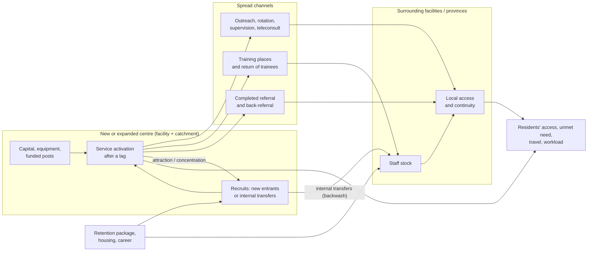

# Backwash, spread and rural anchoring: mechanisms, evidence and first scenario design

Date: 14 October 2026. Implements backlog item 7 of the [next-phase plan](next_phase_development_plan_2026-10-14.md) (§7).

Everything below is a proposed application of Myrdal's cumulative-causation framework to workforce planning. **No effect here has been estimated.** The existing M5 supply–service association and the N-FB feedback coefficient do not identify attraction, retention or spread (plan §7.3). Every mechanism therefore enters a scenario as a separately named parameter with an evidence status and a zero or adverse case.

## Mechanism diagram

Two of the arrows decide whether a centre helps its hinterland:

- **Internal transfers (backwash):** staff move from surrounding facilities into the centre.
- **Spread channels:** outreach, training and referral carry capacity back out.

A centre's opening does not automatically apply a rural workforce multiplier. Each arrow is a scenario parameter, set by default to its zero-effect value.

## Evidence the repository can already provide (Chapter 4 descriptive audit)

| Question | Data available | Limitation |
|---|---|---|
| Are specialists concentrating in a few facilities, and is that changing? | `spc_aggregated.csv`, facility × 18 specialties, 2015–2024 | Coverage break in 2016; GIS Health returns; no nephrology or oncology categories |
| Did cadre headcount at community hospitals fall where a regional centre grew? | `hrh_aggregated.csv` + `hosp.csv` (facility type, location) | Headcount only; co-movement is descriptive, not causal |
| Province-level recruitment and exit around large hospitals | HROPS events by province, FY2017–2025 | No origin–destination, so internal moves cannot be traced |
| Distance between provinces | Province geometry (great-circle) | Not patient travel time; no road network |

These support a **descriptive** concentration audit:

- concentration indices of specialists across facilities over time;
- facility-type trajectories by province.

They cannot support an effect estimate.

## First scenario experiment (plan §7.2), specified for implementation

For a named facility and catchment, every scenario is evaluated on the same population under the same resource envelope.

| # | Scenario | What changes |
|---|---|---|
| 1 | No new centre | Existing expansion rules (current allocator) |
| 2 | Centre only | Funded posts at the centre, filled by new entrants **and** internal transfers in a stated proportion; no outreach or retention package |
| 3 | Centre + network | Scenario 2, plus outreach and rotation time, training places with a return share, and a retention change in the donor areas |
| 4 | Distributed package | The same workforce, or the same budget where costs exist, spread across community facilities |

**Mechanism parameters.** Every default is zero.

| Parameter | Unit | Notes |
|---|---|---|
| `transfer_share_of_centre_recruits` | share | — |
| `activation_lag_years` | years | — |
| `outreach_fte_share` | share | — |
| `trainee_return_share` | share | — |
| `donor_retention_change` | hazard ratio | — |
| `attraction_effect` | hazard ratio for recruitment | Applies to the centre's province |

Each parameter is run at zero, at an adverse value and at a favourable value. Defaults change only with identified evidence.

**Required outputs:**

- net FTE gain for the system;
- donor-area losses;
- access and travel for the poorest-access group;
- unmet need;
- continuity;
- budget.

The report shows the centre, its neighbours and the whole system side by side.

**Accounting constraints:**

- Internal moves must balance across origins and destinations, with flows to or from Bangkok and other sectors shown as boundary flows.
- A facility without its full team and equipment does not count as operating capacity.
- Workforce moves and patient referrals are separate networks.

The existing allocator already balances internal transfers on a complete or regional network (`allocation.route`). Scenarios 2–3 can reuse that balance with the centre as a destination. Patient referrals need a new network.

## Empirical evaluation later (plan §7.3)

A causal estimate needs, at minimum:

- dated openings and expansions;
- pre-opening outcomes;
- comparable areas;
- workforce and patient flows.

Event-study, difference-in-differences or synthetic-control designs are appropriate only if timing, comparison groups and pre-trends support them. They must also handle spillovers into nearby controls. Until then, results stay descriptive or scenario ranges.

The data needed are listed in [data_requests.md](data_requests.md) (rows 9–12).
