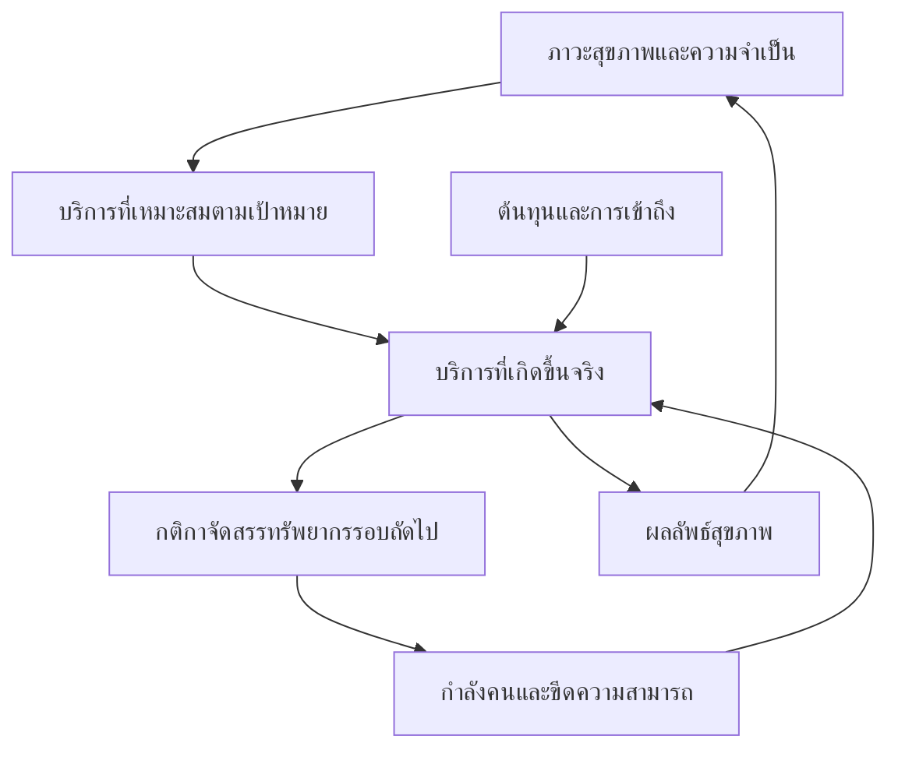

# หัวข้อ 4.2 กำลังคนเพิ่มขึ้นเมื่อเทียบกับอะไร

ร่างภาษาไทยและคำสั่งวิเคราะห์สำหรับ Jupyter notebook ใหม่โดยเฉพาะ

เอกสารนี้จัดทำโดยอ่าน **4.1 ความจริงของจำนวนที่เพิ่มขึ้น.docx ฉบับที่ผู้เขียนส่งวันที่ 21 กันยายน 2026** เพื่อรักษาน้ำเสียง การเรียงข้อค้นพบ และขอบเขตข้อมูลที่ใช้อยู่ งานนี้เป็นการออกแบบการวิเคราะห์และร่างเนื้อหา ยังไม่ได้ดำเนินการวิเคราะห์ฐานข้อมูลจริงของ 4.2

ส่งไฟล์นี้ทั้งไฟล์ให้ agent ที่เข้าถึงโครงการได้ โดยให้ใช้ **ส่วน B** เป็นแม่แบบรายงาน และลงมือทำตาม **ส่วน C** ข้อมูลเพิ่มเติมที่ยังต้องสอบถามอยู่ใน **ส่วน D** หากยังไม่ได้รับคำตอบ ให้สำรวจข้อมูลที่มีและทำส่วนที่รองรับได้ตามลำดับ โดยไม่สมมติว่าข้อมูลที่ไม่ได้ยืนยันนั้นมีอยู่แล้ว

## ส่วน A ข้อเสนอเชิงบรรณาธิการและกรอบการวิเคราะห์

### A1 สิ่งที่ควรรักษาจาก 4.1

ใช้การเล่าเรื่องจากข้อค้นพบไปสู่ความหมายและข้อจำกัด อธิบายความแตกต่างระหว่างขอบเขตข้อมูลก่อนเปรียบเทียบ ใช้คำว่า “ความหนาแน่นต่อประชากร” และไม่ให้วิธีสถิติกลายเป็นเนื้อหาหลักของทุกย่อหน้า เก็บสมการและรายละเอียดการประมาณไว้ในวิธีวิเคราะห์/notebook ส่วนเนื้อหาหลักอธิบายว่าตัวเลขตอบคำถามใด

4.2 ต้องเดินต่อจากข้อสรุปของ 4.1 ว่า จำนวนกำลังคนและบริการยังไม่ยืนยันความเพียงพอ ไม่ย้อนเล่าตัวเลขการเติบโตทั้งหมดซ้ำ และยังไม่ทำบทวิเคราะห์ความเหลื่อมล้ำระหว่างจังหวัดซึ่งเป็นหน้าที่ของหัวข้อถัดไป แม้จะใช้ข้อมูลจังหวัดในการประมาณแบบจำลองก็ตาม

### A2 จุดที่ต้องประสานกับฉบับล่าสุดก่อนเติมผล

- จำนวนพยาบาลวิชาชีพปี 2013 ใน 4.1 ฉบับล่าสุดเป็น **131,349 คน** ไม่ใช่ 138,205 คนในร่างก่อนหน้า ต้องยืนยันกับข้อมูลต้นทางแล้วใช้ฐานเดียวกันทั้งบท
- ถ้าจำนวนประชากรที่ผู้เขียนยกมา 63,650,593 และ 64,596,347 คนได้รับการยืนยัน การใช้จำนวนแพทย์และพยาบาลจาก 4.1 ฉบับล่าสุดจะให้ความหนาแน่นรวมประมาณ **2.48 → 3.86 ต่อ 1,000 คน** ไม่ใช่ 2.59 → 3.86 ข้อนี้เป็นการตรวจเลขจากร่าง ไม่ใช่ผลวิเคราะห์ฐานข้อมูลใหม่
- จากตัวเลขข้างต้น “เป็นร้อยละของระดับอ้างอิง 4.45 ในปีปลายช่วง” ประมาณ 86.68% ส่วน “ปิดช่องว่างจากจุดตั้งต้นถึงระดับอ้างอิงได้เท่าใด” ประมาณ 69.85% เป็นคนละตัวชี้วัด อย่าใช้คำว่า “ก้าวหน้าถึงร้อยละ 70 ของเกณฑ์” โดยไม่ระบุความหมาย
- ตัวหารทะเบียนราษฎรต้องตรวจว่านับคนสัญชาติไทยหรือรวมคนไม่มีสัญชาติไทย และทะเบียนสิทธิต้องตรวจว่าเป็นยอดบุคคลไม่ซ้ำหรือยอดสิทธิ ห้ามสรุปว่ายอดต่างเกิดจากคนต่างชาติทั้งหมดก่อนตรวจ metadata
- เกณฑ์ 4.45 ต้องอธิบายขอบเขตแพทย์ พยาบาล และผดุงครรภ์ รวมถึงการนับซ้ำ/การรวมผู้ประกอบวิชาชีพพยาบาลและผดุงครรภ์ ไม่เป็นเกณฑ์ที่ใช้รับรองความเพียงพอของประเทศไทยจากตัวเลขเดียว [R1–R3]
- บริการ MOPH ใน 4.1 บางชุดหมายถึง **โรงพยาบาลศูนย์ โรงพยาบาลทั่วไป และโรงพยาบาลชุมชน สังกัดสำนักงานปลัดกระทรวงฯ** ไม่รวม รพ.สต. ต้องใช้จำนวนบุคลากรในหน่วยบริการชุดเดียวกันก่อนคำนวณภาระบริการต่อคน
- ข้อมูล OP persons มีข้อสังเกตเรื่องความต่อเนื่อง ส่วน AdjRW/CMI ใช้ปีงบประมาณ เริ่มปี 2018 และมีข้อสังเกตเรื่อง DRG หลังปี 2023 ตามเอกสารของผู้เขียน อย่านำไปต่อรวมกับชุดปีปฏิทินโดยไม่ตรวจสอบ
- เลขหัวข้อท้ายร่างแก้เป็น **4.2.4** จาก 4.4.4 และใช้รูปที่ **6–9** ต่อจากรูปที่ 1–5 ใน 4.1 ฉบับล่าสุด ให้ตั้งเลขรูปเป็น configuration ที่แก้ได้

### A3 ข้อเสนอหลักสำหรับ 4.2.3

**ไม่ควรเริ่มด้วยการหาน้ำหนักชุดเดียวที่พยากรณ์บริการได้ดีที่สุด แล้วเรียกผลนั้นว่า “ความจำเป็นที่แท้จริง”** ควรแยกงานสองส่วนที่ช่วยตรวจสอบกัน:

1. **ศึกษาว่าบริการที่เกิดขึ้นสัมพันธ์กับอะไร**: ประชากร/อายุ ภาวะสุขภาพ การเข้าถึง และกำลังการให้บริการ ช่วยพยากรณ์บริการที่ไม่ได้ใช้ฝึกแบบจำลองได้มากน้อยเพียงใด วิธีนี้ตอบเรื่องกระบวนการเกิดบริการและขอบเขตของตัวชี้วัด
2. **ประมาณบริการที่ควรได้รับภายใต้เป้าหมายที่ระบุ**: ประชากรมีภาวะสุขภาพอะไร รวมผู้ยังไม่ได้วินิจฉัยและไม่ได้ใช้บริการ; ตามหลักฐานและเป้าหมายที่เลือกควรได้รับการดูแลใด; การดูแลนั้นต้องใช้เวลาและทักษะของบุคลากรเท่าใด วิธีนี้ตอบเรื่องกำลังคนที่จำเป็นภายใต้ข้อตกลงการดูแล [R5–R6]

วิธีที่สองไม่จำเป็นต้องถูกต้องเพราะตรงกับ utilization ปัจจุบัน การที่แบบจำลองความจำเป็นให้ค่าต่างจากบริการจริงอาจเป็นประเด็นสำคัญที่ต้องอธิบาย แต่ส่วนต่างดังกล่าวยังไม่เท่ากับ unmet need ที่ยืนยันแล้ว เพราะอาจเกิดจากความผิดพลาดของข้อมูล การส่งต่อ ความเหมาะสมของ care package หรือรูปแบบการดูแลที่ต่างกัน

โครงสร้างอายุเป็นจุดเริ่มต้นที่มีประโยชน์ แต่ความจำเป็นยังอาจต่างกันภายในกลุ่มอายุเดียวกัน เช่น ภาวะเจ็บป่วยหลายโรค ความพิการ การพึ่งพิง ความเสี่ยงของโรค และความสามารถในการดูแลตนเอง น้ำหนักบริการตามอายุที่คำนวณจากการใช้บริการเดิมจึงเป็น **น้ำหนักการใช้บริการตามอายุ** ไม่ใช่หลักฐานว่ารวมความจำเป็นทั้งหมดแล้ว

### A4 กรอบเต็มเมื่อยังไม่จำกัดข้อมูล

ตั้งหน่วยเริ่มต้นที่ประชาชนตามถิ่นที่อยู่ เชื่อมข้อมูลสำรวจสุขภาพและการตรวจร่างกาย ข้อมูลสิทธิ และข้อมูลบริการ/ผลลัพธ์ โดยมีแผนจัดการการนับซ้ำและความเป็นส่วนตัวที่สอดคล้องกับสิทธิการใช้ข้อมูล จากนั้นแบ่งภาวะสุขภาพที่สัมพันธ์กับการดูแลจริง เช่น ไม่มีโรคแต่เข้าเกณฑ์ป้องกันโรค โรคที่ยังไม่วินิจฉัย โรคที่วินิจฉัยแล้วแต่ไม่ได้รักษา โรคที่ควบคุมได้/ไม่ได้ ภาวะแทรกซ้อน และภาวะพึ่งพิง

แปลงภาวะสุขภาพเป็น **ชุดการดูแลที่เหมาะสมภายใต้เป้าหมายความครอบคลุมและคุณภาพที่ระบุ** แล้วแปลงชุดการดูแลเป็นเวลาทำงานแยกวิชาชีพ โดยไม่กำหนดเป้าหมายการดูแลจากจำนวนหมอหรือจำนวนบริการที่มีอยู่ในพื้นที่นั้น

จึงค่อยนำความต้องการทรัพยากรนี้เข้าแบบจำลองที่มีข้อจำกัดด้านกำลังคน งบประมาณ โครงสร้างบริการ การเดินทาง การส่งต่อ และทางเลือกการแบ่งงานระหว่างวิชาชีพ พร้อมผลของการป้องกันและรักษาต่อภาวะสุขภาพในปีถัดไป สิ่งที่ควรเปรียบเทียบคือการเข้าถึงบริการที่จำเป็น ผลลัพธ์สุขภาพ ภาระงาน และความเหลื่อมล้ำภายใต้แต่ละทางเลือก ไม่ใช่เพียงจำนวนครั้งบริการที่มากที่สุด

กรอบนี้อาจพัฒนาเป็น microsimulation/ABM ร่วมกับการจัดสรรทรัพยากรภายใต้ข้อจำกัดได้ในบทแบบจำลองภายหลัง โดย 4.2 ทำหน้าที่สร้างฐานการวัดและตรวจสอบองค์ประกอบก่อน ไม่จำเป็นต้องสร้างแบบจำลองระดับประเทศทั้งหมดเสร็จในหัวข้อนี้

### A5 General equilibrium และวงจรการจัดสรรตามบริการ

การที่อุปสงค์กับอุปทานดุลกันในแบบจำลองตลาด ไม่ได้กำหนดเองว่าประชาชนได้รับการดูแลที่จำเป็นครบถ้วน ภายใต้งบประมาณและต้นทุนการเข้าถึงที่มีอยู่ ระบบอาจมีดุลยภาพพร้อมกับความจำเป็นที่ยังไม่ได้รับการตอบสนองได้ จึงต้องระบุเป้าหมายด้านสุขภาพและความเป็นธรรมแยกจากเงื่อนไขดุลยภาพ

สำหรับคำถามนี้ ควรเริ่มจาก **แบบจำลองที่เชื่อมความจำเป็น บริการ และกำลังคนภายใต้ข้อจำกัดร่วมกัน** หากจะเรียกเป็น general equilibrium อย่างเป็นทางการ ต้องเพิ่มพฤติกรรมครัวเรือน ผู้ให้บริการ ผู้จ่ายเงิน ตลาดแรงงาน/ค่าจ้าง งบประมาณ การผลิตและเคลื่อนย้ายบุคลากร และเงื่อนไขที่ทำให้ทุกส่วนสอดคล้องกัน แบบจำลอง regression ของ utilization หรือการวนคำนวณ workforce จาก utilization เพียงอย่างเดียวไม่ใช่ general equilibrium [R7]

วงจรที่ผู้เขียนตั้งข้อสงสัยอาจเรียกว่า **Success to the Successful** หรือการจัดสรรที่เอื้อให้พื้นที่ซึ่งมีทรัพยากรอยู่แล้วได้รับทรัพยากรเพิ่ม แต่ความสัมพันธ์เชิงบวกระหว่างแพทย์กับบริการเพียงอย่างเดียวไม่พิสูจน์วงจรนี้ และไม่พิสูจน์ supplier-induced demand บริการอาจเพิ่มเพราะตอบ unmet need การส่งต่อ การตรวจพบโรค หรือการจัดสรรตามภาระที่มีอยู่จริงก็ได้ ต้องมีหลักฐานกติกาการจัดสรรและลำดับเวลาด้วย

แผนภาพนี้เป็น **สมมติฐานเชิงแนวคิด** ไม่ใช่ผลการประมาณ:

ลูกศรในวงจรเป็นความสัมพันธ์ข้ามเวลา; เครื่องหมายและขนาดขึ้นกับกลไกจริง การรักษาที่มีประสิทธิผลอาจลดภาวะแทรกซ้อนในอนาคต ขณะที่การรอดชีวิตที่ดีขึ้นอาจเพิ่มจำนวนผู้ต้องการการดูแลระยะยาว จึงไม่กำหนดผลสุทธิไว้ล่วงหน้า

---

## ส่วน B ร่างรายงานพร้อม placeholder

### 4.2 กำลังคนเพิ่มขึ้นเมื่อเทียบกับอะไร

ผลการวิเคราะห์ในส่วนที่ผ่านมาแสดงให้เห็นว่า จำนวนกำลังคนและบริการด้านสุขภาพเปลี่ยนแปลงไปอย่างไรในช่วงที่ศึกษา อย่างไรก็ตาม การเพิ่มขึ้นของจำนวนยังไม่เพียงพอสำหรับการพิจารณาความก้าวหน้า หากยังไม่ได้ระบุว่าเป็นการเพิ่มขึ้นเมื่อเทียบกับอะไร จำนวนบุคลากรที่เพิ่มขึ้นในขณะที่ประชากรเปลี่ยนแปลงเพียงเล็กน้อย อาจให้ภาพที่แตกต่างจากการนำบุคลากรจำนวนเดียวกันไปพิจารณาร่วมกับปริมาณบริการหรือความจำเป็นด้านสุขภาพของประชาชน การเลือกตัวหารจึงเป็นส่วนหนึ่งของการกำหนดความหมายของความก้าวหน้า และอาจนำไปสู่ข้อเสนอในการวางแผนทรัพยากรที่แตกต่างกันด้วย

การวิเคราะห์ส่วนนี้จึงพิจารณาจำนวนกำลังคนเทียบกับตัวหารสามกลุ่ม ได้แก่ จำนวนประชากร บริการที่เกิดขึ้น และตัวชี้วัดที่พยายามสะท้อนความจำเป็นด้านสุขภาพ โดยแต่ละกลุ่มมีขอบเขตของคำตอบและข้อจำกัดต่างกัน การพิจารณาตามลำดับดังกล่าวมีจุดมุ่งหมายเพื่อทำความเข้าใจว่าภาพความก้าวหน้าเปลี่ยนแปลงไปอย่างไรเมื่อเปลี่ยนกรอบการวัด ตลอดจนชี้ให้เห็นข้อมูลและข้อตกลงที่ยังจำเป็นต่อการประเมินความเพียงพอของกำลังคนต่อไป

#### 4.2.1 เทียบกับจำนวนประชากร

การเปรียบเทียบที่ดูจะซับซ้อนน้อยที่สุดคือการพิจารณาจำนวนบุคลากรเทียบกับ “จำนวนคน” ความหนาแน่นของกำลังคนต่อประชากรช่วยให้สามารถเปรียบเทียบจำนวนบุคลากรระหว่างช่วงเวลาหรือระหว่างพื้นที่ที่มีขนาดประชากรต่างกันได้ ในช่วง พ.ศ. [[POP_START_BE]]–[[POP_END_BE]] ข้อมูล [[POP_SOURCE_AND_SCOPE]] แสดงจำนวนประชากรเปลี่ยนจาก [[POP_START]] คน เป็น [[POP_END]] คน หรือ[[POP_DIRECTION]]ร้อยละ [[POP_CHANGE_ABS_PCT]] คิดเป็นอัตราการเติบโตเฉลี่ยแบบทบต้นร้อยละ [[POP_CAGR]] ต่อปี เมื่อเปรียบเทียบกับการเปลี่ยนแปลงของกำลังคนในช่วงเดียวกัน พบว่า [[INTERP_POP_VS_WORKFORCE]]

เมื่อคำนวณด้วยจำนวนประชากรดังกล่าว ความหนาแน่นของแพทย์ทุกสังกัดเปลี่ยนจาก [[DENSITY_PHYSICIANS_START]] เป็น [[DENSITY_PHYSICIANS_END]] คนต่อประชากร 100,000 คน พยาบาลวิชาชีพจาก [[DENSITY_NURSES_START]] เป็น [[DENSITY_NURSES_END]] คนต่อประชากร 100,000 คน ส่วนเภสัชกรและทันตแพทย์มีความหนาแน่นเปลี่ยนแปลง [[DENSITY_OTHER_CADRES]] [[INTERP_CRUDE_DENSITY: สรุปว่าการเปลี่ยนแปลงของความหนาแน่นต่างจากการเปลี่ยนแปลงจำนวนเพียงใด โดยไม่ตีความความหนาแน่นที่เพิ่มขึ้นว่าเท่ากับความเพียงพอ]]

สำหรับการพิจารณาแพทย์และพยาบาลวิชาชีพร่วมกัน ความหนาแน่นเปลี่ยนจาก [[COMBINED_DENSITY_START]] เป็น [[COMBINED_DENSITY_END]] คนต่อประชากร 1,000 คน การเปรียบเทียบกับระดับอ้างอิง 4.45 คนต่อประชากร 1,000 คนที่ใช้ในกรอบกำลังคนขององค์การอนามัยโลก จำเป็นต้องตรวจสอบความสอดคล้องของกลุ่มวิชาชีพก่อน เนื่องจากระดับอ้างอิงดังกล่าวครอบคลุมแพทย์ พยาบาล และผดุงครรภ์ ในข้อมูลชุดนี้ [[MIDWIFERY_COMPARABILITY_NOTE]] หากพิจารณาเป็นการเปรียบเทียบเชิงอ้างอิงตามขอบเขตที่ระบุ ความหนาแน่นในปีปลายช่วงคิดเป็นร้อยละ [[BENCHMARK_ATTAINMENT_PCT]] ของระดับอ้างอิง และปิดช่องว่างจากจุดตั้งต้นได้ร้อยละ [[BENCHMARK_INITIAL_GAP_CLOSED_PCT]] ตัวเลขสองค่าดังกล่าวตอบคนละคำถาม และไม่ควรใช้แทนกัน [R1–R3]

คำถามต่อมาคือ หากแนวโน้มดำเนินต่อไป ความหนาแน่นดังกล่าวจะถึงระดับอ้างอิงภายใน พ.ศ. 2573 หรือไม่ ภายใต้ฉากทัศน์ [[BENCHMARK_SCENARIO_ASSUMPTIONS]] ผลการคำนวณให้ความหนาแน่นในปีดังกล่าวอยู่ที่ [[COMBINED_DENSITY_2030_SCENARIOS]] และปีที่ถึงระดับอ้างอิงเป็น [[BENCHMARK_CROSSING_YEAR_SCENARIOS]] [[INTERP_BENCHMARK_SCENARIOS]] ทั้งนี้ เป็นการต่อแนวโน้มภายใต้สมมติฐานที่ระบุ มิใช่การพยากรณ์ความเพียงพอของระบบสุขภาพ และการถึงระดับอ้างอิงก็มิได้ยืนยันว่าความจำเป็นของประชากรทุกกลุ่มได้รับการตอบสนองแล้ว

เมื่อจำกัดจำนวนบุคลากรเฉพาะภาครัฐ โดยรวมทั้งกระทรวงสาธารณสุขและหน่วยงานภาครัฐอื่น ๆ ความหนาแน่นเปลี่ยนแปลง [[PUBLIC_DENSITY_RESULTS]] ขณะที่ความหนาแน่นเฉพาะบุคลากรในสังกัด [[MOPH_WORKFORCE_SCOPE]] เปลี่ยนแปลง [[MOPH_DENSITY_RESULTS]] [[INTERP_SECTOR_DENSITY]] การใช้ประชากรทั้งประเทศเป็นตัวหารร่วมในที่นี้ช่วยแสดงขนาดของกำลังคนแต่ละสังกัดเมื่อเทียบกับประชากรฐานเดียวกัน แต่ไม่ถือว่าประชากรทุกคนใช้บริการของแต่ละสังกัดในสัดส่วนเท่ากัน หรือว่าภาครัฐและเอกชนทดแทนกันได้โดยไม่มีข้อจำกัด

นอกจากนี้ จำนวนประชากรตามทะเบียนราษฎรอาจแตกต่างจากจำนวนบุคคลตามทะเบียนสิทธิการรักษาพยาบาล เนื่องจากฐานข้อมูลแต่ละชุดมีวัตถุประสงค์ ขอบเขตการนับ และเวลาที่ปรับปรุงต่างกัน ในปี พ.ศ. [[REGISTER_COMPARISON_YEAR_BE]] ที่สามารถเปรียบเทียบได้ จำนวนประชากรตามทะเบียนราษฎรเท่ากับ [[CIVIL_REGISTER_COUNT]] คน ขณะที่จำนวนบุคคลตามทะเบียนสิทธิ [[RIGHTS_REGISTER_SCOPE]] เท่ากับ [[RIGHTS_REGISTER_COUNT]] คน หรือแตกต่างกันร้อยละ [[REGISTER_DIFFERENCE_PCT]] เมื่อคงจำนวนบุคลากรเดิมแล้วเปลี่ยนตัวหาร ความหนาแน่นจึง[[REGISTER_DENSITY_DIRECTION]]ร้อยละ [[REGISTER_DENSITY_CHANGE_ABS_PCT]] [[INTERP_REGISTER_COMPARISON: ระบุผลและข้อจำกัดของทะเบียนที่ตรวจสอบได้ โดยไม่อ้างเหตุผลเรื่องสัญชาติหรือสิทธิซ้ำเกินหลักฐาน]]

ผลข้างต้นแสดงให้เห็นว่า แม้จะเปรียบเทียบกับจำนวนคนเช่นเดียวกัน ภาพความหนาแน่นก็ยังขึ้นอยู่กับทั้งขอบเขตบุคลากรที่นำมานับและนิยามประชากรที่ใช้เป็นตัวหาร ความแตกต่างนี้ยังมิได้พิจารณาว่าประชากรแต่ละคนมีความจำเป็นด้านสุขภาพมากน้อยเพียงใด ซึ่งเป็นคำถามที่ต้องพิจารณาเพิ่มเติมจากการนับจำนวนประชากรเพียงอย่างเดียว

> **[ตำแหน่งรูปที่ 6] ความหนาแน่นของกำลังคนต่อประชากรภายใต้ขอบเขตการนับที่แตกต่างกัน**  
> A แนวโน้มความหนาแน่นรายวิชาชีพ แยกทุกสังกัด ภาครัฐ และกระทรวงสาธารณสุข โดยใช้ประชากรฐานเดียวกัน  
> B ความหนาแน่นแพทย์และพยาบาลรวม ระดับอ้างอิง และฉากทัศน์ถึงปี 2030 โดยระบุขอบเขตผดุงครรภ์  
> C การเปรียบเทียบจำนวนบุคลากรสามขอบเขตกับประชากรสองทะเบียนในปีที่ตรงกัน แสดงเป็นกราฟจุดจับคู่แยกวิชาชีพ  
> *ข้อมูลฉายแนวโน้มต้องแยกจากข้อมูลจริงด้วยเส้นประและระบุสมมติฐาน; ไม่ใช้เกณฑ์ระดับประเทศตัดสินความเพียงพอของแต่ละสังกัดแยกกัน*

#### 4.2.2 หรือเทียบกับจำนวนบริการ

การนำกำลังคนไปพิจารณาร่วมกับจำนวนบริการทำให้คำถามเปลี่ยนจากการมีบุคลากรมากน้อยเพียงใดเมื่อเทียบกับประชากร ไปสู่การมีบุคลากรมากน้อยเพียงใดเมื่อเทียบกับงานบริการที่เกิดขึ้น อย่างไรก็ตาม การคำนวณดังกล่าวจำเป็นต้องจับคู่จำนวนบุคลากรและบริการจากหน่วยบริการขอบเขตเดียวกัน มิฉะนั้น การเปลี่ยนแปลงที่พบอาจเกิดจากการนับบุคลากรครอบคลุมกว้างกว่างานบริการที่นำมาเปรียบเทียบ

เมื่อพิจารณา [[MATCHED_FACILITY_SCOPE]] ในช่วง พ.ศ. [[WORKLOAD_START_BE]]–[[WORKLOAD_END_BE]] จำนวนครั้งรับบริการผู้ป่วยนอกต่อแพทย์หนึ่งคนเปลี่ยนจาก [[OP_PER_PHYSICIAN_START]] เป็น [[OP_PER_PHYSICIAN_END]] ครั้งต่อปี และจำนวนวันนอนรวมต่อพยาบาลวิชาชีพหนึ่งคนเปลี่ยนจาก [[IP_DAYS_PER_NURSE_START]] เป็น [[IP_DAYS_PER_NURSE_END]] วันต่อปี [[OTHER_MATCHED_SERVICE_METRICS]] [[INTERP_SERVICE_PER_WORKER]] ตัวเลขเหล่านี้เป็นการเปรียบเทียบปริมาณบริการกับจำนวนบุคลากรของหน่วยบริการในภาพรวม ไม่ใช่เวลาที่บุคลากรแต่ละคนทำงานจริง หรือหลักฐานว่าบุคลากรทุกคนทำกิจกรรมเดียวกัน

มากกว่านั้น งานบริการแต่ละประเภทใช้เวลาและทักษะต่างกัน การนับผู้ป่วยนอกหนึ่งครั้งเท่ากับวันนอนหนึ่งวันจึงไม่ช่วยให้เห็นภาระงานรวมอย่างเหมาะสม หากมีข้อมูลเวลามาตรฐานของกิจกรรมและการแบ่งงานระหว่างวิชาชีพ สามารถแปลงบริการแต่ละประเภทเป็นชั่วโมงทำงานที่จำเป็นตามมาตรฐาน แล้วรวมเป็นภาระงานรายปีแยกวิชาชีพได้ แนวคิดการใช้เวลามาตรฐานกับปริมาณงานสอดคล้องกับวิธี Workload Indicators of Staffing Need หรือ WISN ขององค์การอนามัยโลก แต่การประยุกต์ใช้ในที่นี้ต้องระบุให้ชัดว่าครอบคลุมงานประเภทใดบ้าง [R4]

ภายใต้เวลามาตรฐาน [[TIME_STANDARD_SOURCE_AND_SCOPE]] ชั่วโมงทำงานที่จำเป็นสำหรับบริการที่รายงานอยู่ที่ [[REQUIRED_SERVICE_HOURS_BY_CADRE]] ชั่วโมงต่อปี หรือ [[REQUIRED_HOURS_PER_WORKER_BY_CADRE]] ชั่วโมงต่อบุคลากรหนึ่งคนต่อปี เมื่อเปรียบเทียบกับเวลาที่สามารถใช้ให้บริการได้ตามสมมติฐาน [[AVAILABLE_TIME_ASSUMPTIONS]] พบว่า [[OBSERVED_WORKLOAD_PRESSURE_RESULTS]] [[INTERP_STANDARDIZED_WORKLOAD: อธิบายผลพร้อมขอบเขตกิจกรรมและความไวต่อเวลามาตรฐาน แยกชั่วโมงตามมาตรฐานออกจากชั่วโมงที่ทำงานจริง]]

อย่างไรก็ตาม ผลรวมน้ำหนักสัมพัทธ์ที่ปรับแล้วมิได้มีหน่วยเป็นเวลาทำงานของแพทย์หรือพยาบาลโดยตรง การนำ AdjRW มาแปลงเป็นชั่วโมงจึงต้องมีหลักฐานการสอบเทียบกับเวลาของแต่ละวิชาชีพเพิ่มเติม หากยังไม่มีข้อมูลดังกล่าว การวิเคราะห์จะรายงานผลเป็น [[WORKLOAD_FALLBACK_OUTPUT: ภาระบริการแยกประเภทหรือดัชนีภาระบริการภายใต้น้ำหนักสมมติฐานที่เปิดเผย]] และยังไม่สรุปเป็นจำนวนชั่วโมงทำงานหรือจำนวนบุคลากรที่ขาดจริง

ข้อจำกัดที่สำคัญกว่านั้นคือ ภาระงานจากบริการที่เกิดขึ้นบอกถึงงานที่เข้าสู่ระบบแล้ว ขณะที่ผู้ที่มีความจำเป็นแต่ยังไม่สามารถเข้าถึงบริการอาจไม่ปรากฏอยู่ในตัวหาร พื้นที่ที่มีบุคลากรจำกัดจนให้บริการได้น้อยจึงอาจดูเหมือนมีภาระบริการต่อบุคลากรไม่สูง ในทางกลับกัน พื้นที่ที่มีขีดความสามารถสูงอาจรับบริการทั้งของประชาชนในพื้นที่และผู้ป่วยส่งต่อ การวางแผนจากปริมาณบริการจึงมีประโยชน์ต่อการจัดการงานที่เกิดขึ้น แต่ยังต้องพิจารณาควบคู่กับความจำเป็นที่อาจไม่ปรากฏเป็นบริการด้วย

> **[ตำแหน่งรูปที่ 7] กำลังคนเมื่อเทียบกับบริการและภาระงานตามเวลามาตรฐาน**  
> A ดัชนีบุคลากรต่อบริการ แยกประเภทบริการและวิชาชีพ ในขอบเขตหน่วยบริการเดียวกัน พร้อมตารางค่าจริงของบริการต่อคน  
> B ชั่วโมงงานตามมาตรฐานต่อคนต่อปีหรือแรงกดดันภาระงานต่อ FTE พร้อมช่วงความไวของสมมติฐาน  
> *สร้าง B เมื่อมีเวลามาตรฐานและข้อมูลตัวส่วนเพียงพอ มิฉะนั้นใช้ดัชนีภาระบริการและป้ายบอกหน่วยอย่างตรงไปตรงมา ไม่แปลง AdjRW เป็นนาทีโดยไม่มีฐานอ้างอิง*

#### 4.2.3 หรือเทียบกับความจำเป็นด้านสุขภาพ

หากการใช้จำนวนประชากรยังไม่คำนึงถึงความแตกต่างของภาวะสุขภาพ และการใช้บริการที่เกิดขึ้นยังไม่ครอบคลุมความจำเป็นที่อยู่นอกระบบ คำถามต่อมาคือ เราจะพิจารณาจำนวนกำลังคนเทียบกับความจำเป็นด้านสุขภาพของประชาชนได้อย่างไร ในเชิงหลักการ พื้นที่หรือประชากรที่มีความจำเป็นมากกว่าย่อมมีเหตุผลที่จะได้รับทรัพยากรมากกว่า แต่การนำหลักการนี้ไปใช้จำเป็นต้องระบุทั้งสิ่งที่ถือเป็นความจำเป็นและบริการที่เหมาะสมสำหรับตอบสนองความจำเป็นนั้น

โครงสร้างอายุเป็นจุดเริ่มต้นหนึ่งของการพิจารณาดังกล่าว เนื่องจากการเปลี่ยนแปลงสัดส่วนประชากรแต่ละวัยอาจสัมพันธ์กับแบบแผนการเจ็บป่วยและการใช้บริการ แม้จำนวนประชากรรวมจะเปลี่ยนแปลงไม่มากก็ตาม เมื่อถ่วงจำนวนประชากรตามน้ำหนัก [[AGE_WEIGHT_DEFINITION_AND_SOURCE]] โดยตรึงน้ำหนักไว้ตลอดช่วงที่เปรียบเทียบ พบว่า ประชากรถ่วงน้ำหนักเปลี่ยนจาก [[AGE_WEIGHTED_POP_START]] เป็น [[AGE_WEIGHTED_POP_END]] หน่วยประชากรเทียบเท่า คิดเป็นอัตราการเติบโตเฉลี่ยร้อยละ [[AGE_WEIGHTED_POP_CAGR]] ต่อปี เทียบกับร้อยละ [[CRUDE_POP_COMMON_PERIOD_CAGR]] ต่อปีของประชากรที่ไม่ได้ถ่วงน้ำหนัก เมื่อใช้เป็นตัวหารเดียวกันสำหรับกำลังคน พบว่า [[AGE_ADJUSTED_WORKFORCE_RESULTS]] [[INTERP_AGE_ADJUSTMENT]]

อย่างไรก็ตาม หากน้ำหนักตามอายุได้มาจากการใช้บริการที่สังเกตได้ น้ำหนักนั้นย่อมสะท้อนทั้งแบบแผนสุขภาพและเงื่อนไขที่ทำให้บริการเกิดขึ้นในช่วงที่ใช้คำนวณด้วย ประชากรในวัยเดียวกันอาจมีภาระโรค ความพิการ หรือข้อจำกัดในการดูแลตนเองต่างกัน การถ่วงด้วยอายุจึงช่วยขยายความเข้าใจจากจำนวนคน แต่ยังไม่ควรถูกถือว่าเป็นการวัดความจำเป็นทั้งหมดโดยอัตโนมัติ

เพื่อพิจารณาว่าข้อมูลแต่ละกลุ่มช่วยอธิบายบริการได้เพียงใด การวิเคราะห์จึงเปรียบเทียบแบบจำลองที่เริ่มจากขนาดและโครงสร้างประชากร แล้วเพิ่มข้อมูลภาวะสุขภาพ [[EPIDEMIOLOGY_VARIABLES_AND_SOURCE]] และข้อมูลการเข้าถึงกับขีดความสามารถในการให้บริการ [[ACCESS_CAPACITY_VARIABLES]] ตามลำดับ โดยประเมินความสามารถในการพยากรณ์ด้วยข้อมูลที่ไม่ได้ใช้ประมาณแบบจำลอง ผลพบว่า [[OUT_OF_SAMPLE_MODEL_RESULTS]] [[INTERP_PREDICTIVE_INCREMENT: ระบุว่าการเพิ่มข้อมูลแต่ละกลุ่มช่วยลดความคลาดเคลื่อนหรือไม่ มากน้อยเพียงใด และผลต่างกันระหว่าง OP visits กับ inpatient-days อย่างไร]]

ส่วนของความแตกต่างระหว่างแบบจำลองที่เกี่ยวข้องกับอายุและภาวะโรคอยู่ที่ [[DEMOGRAPHY_EPIDEMIOLOGY_OVERLAP_RESULTS]] ขณะที่การเพิ่มตัวแปรกำลังคนและทรัพยากรให้ผล [[CAPACITY_ASSOCIATION_RESULTS]] [[INTERP_MODEL_LIMITS: อธิบายความสัมพันธ์ที่ข้อมูลรองรับ ไม่ใช้การเปลี่ยน coefficient หรือความแม่นยำทำนายเป็นสัดส่วนสาเหตุหรือการพิสูจน์ mediation]] การที่จำนวนบุคลากรช่วยพยากรณ์บริการได้ดีขึ้นยังไม่สามารถระบุได้ว่าบุคลากรเป็นผู้ก่อให้เกิดบริการทั้งหมด เพราะความจำเป็นที่สูงอาจนำไปสู่การจัดสรรบุคลากรเพิ่ม ขณะที่บุคลากรที่เพิ่มขึ้นก็อาจช่วยให้ประชาชนเข้าถึงบริการที่เคยไม่ได้รับมาก่อน

การประมาณความจำเป็นเพื่อใช้วางแผนจึงต้องก้าวไปอีกขั้นหนึ่ง โดยเริ่มจากประชากรที่มีภาวะสุขภาพหรือเข้าเกณฑ์การดูแล ไม่จำกัดเฉพาะผู้ที่เข้ารับบริการแล้ว จากนั้นระบุชนิดและความถี่ของบริการที่เหมาะสมตามหลักฐานและเป้าหมายความครอบคลุมที่เลือก ก่อนแปลงเป็นเวลาของแต่ละวิชาชีพ ในการวิเคราะห์นี้ ชุดการดูแล [[NEED_CARE_PACKAGE_SCOPE]] ครอบคลุม [[NEED_POPULATION_AND_CONDITIONS]] ภายใต้เป้าหมาย [[NEED_COVERAGE_QUALITY_ASSUMPTIONS]] โดยจัดการการซ้อนทับของโรคและกิจกรรมด้วย [[MULTIMORBIDITY_HANDLING]] แนวทางนี้ทำให้ความต้องการกำลังคนเชื่อมโยงกับสิ่งที่ประชาชนควรได้รับอย่างเปิดเผย [R5–R6]

ผลการประมาณแสดงชั่วโมงบริการที่จำเป็นเท่ากับ [[NEED_HOURS_BY_CADRE]] หรือเทียบเท่ากำลังคนเต็มเวลา [[NEED_FTE_BY_CADRE]] ภายใต้สมมติฐานที่กำหนด เมื่อเทียบกับกำลังคนที่ปฏิบัติงานอยู่ พบว่า [[NEED_CAPACITY_COMPARISON]] [[INTERP_NORMATIVE_NEED_RESULTS: สรุปเฉพาะภารกิจและประชากรที่แบบจำลองครอบคลุม พร้อมช่วงความไม่แน่นอนและข้อจำกัด ห้ามขยายผลเฉพาะโรคเป็นความต้องการกำลังคนทั้งประเทศทุกภารกิจ]] หากแปลงภาระดังกล่าวเป็นประชากรเทียบเท่าภายใต้น้ำหนักอ้างอิงที่ตรึงไว้ จะได้ [[NEED_EQUIVALENT_POPULATION_RESULTS]] และภาพการเปลี่ยนแปลงของกำลังคนเมื่อใช้ตัวหารนี้เป็น [[NEED_ADJUSTED_WORKFORCE_RESULTS]]

ผลข้างต้นจึงเป็นการประมาณความจำเป็น **ภายใต้ขอบเขตบริการและมาตรฐานการดูแลที่ระบุ** มิใช่ความจำเป็นที่ปราศจากสมมติฐาน การเปลี่ยนเป้าหมายความครอบคลุม คุณภาพการดูแล การแบ่งงานระหว่างวิชาชีพ หรือวิธีจัดบริการ ย่อมเปลี่ยนความต้องการกำลังคนได้ [[SENSITIVITY_NEED_RESULTS]] การเปิดเผยสมมติฐานเหล่านี้ทำให้สามารถพิจารณาได้ว่าข้อสรุปเกิดจากการเปลี่ยนแปลงสุขภาพประชากร หรือเกิดจากการเลือกว่าระบบควรให้การดูแลระดับใด

> **[ข้อความสำรองเมื่อข้อมูลยังไม่เพียงพอสำหรับการประมาณความจำเป็นโดยตรง]**  
> ในข้อมูลที่ใช้ครั้งนี้ ยังไม่มี [[MISSING_NORMATIVE_INPUTS]] เพียงพอที่จะประมาณบริการที่ควรได้รับและเวลาบุคลากรได้ครบถ้วน การวิเคราะห์จึงจำกัดอยู่ที่ [[FEASIBLE_NEED_PROXY_SCOPE]] ซึ่งช่วยตรวจว่าภาพกำลังคนเปลี่ยนไปอย่างไรเมื่อพิจารณาองค์ประกอบประชากรและสุขภาพเพิ่มเติม แต่ยังไม่สามารถระบุจำนวนบุคลากรที่จำเป็นต่อการตอบสนองความจำเป็นทั้งหมดได้ ผลดังกล่าวจึงควรใช้เป็นขอบเขตของความรู้และข้อเสนอด้านข้อมูลสำหรับการวางแผนต่อไป

> **[ตำแหน่งรูปที่ 8] ประชากร ภาวะสุขภาพ และขีดความสามารถช่วยพยากรณ์บริการได้เพียงใด**  
> A ความคลาดเคลื่อนการพยากรณ์นอกชุดฝึกของแบบจำลองประชากร ประชากรและภาวะสุขภาพ และแบบจำลองที่เพิ่มการเข้าถึง/ทรัพยากร ใช้หน่วยและข้อมูลทดสอบเดียวกัน  
> B ผลความสัมพันธ์ของกำลังคน/ทรัพยากรกับบริการภายใต้ข้อกำหนดแบบจำลองที่ต่างกัน พร้อมช่วงความไม่แน่นอนและป้าย “ความสัมพันธ์ มิใช่ผลเชิงสาเหตุ”  
> *ห้ามแปลง R² หรือ feature importance เป็นร้อยละของบริการที่เกิดจากแต่ละสาเหตุ; ถ้าข้อมูลไม่รองรับการประมาณอย่างน่าเชื่อถือ ให้ใช้ตารางข้อจำกัดแทน panel ที่เกี่ยวข้อง*

> **[ตำแหน่งรูปที่ 9] ภาพกำลังคนเมื่อเปลี่ยนตัวหาร และความจำเป็นภายใต้ชุดการดูแลที่ระบุ**  
> A การเติบโตของกำลังคนเมื่อนำไปเทียบกับประชากรเดิม ประชากรถ่วงอายุ และประชากรเทียบเท่าตามความจำเป็นที่ประมาณได้ ใช้ช่วงปี ขอบเขต และกำลังคนชุดเดียวกัน  
> B ความต้องการกำลังคนเต็มเวลาตามความจำเป็น เทียบกับกำลังคนที่มีในภารกิจเดียวกัน พร้อมช่วงความไวต่อชุดการดูแล/เวลา; สร้างเมื่อข้อมูลรองรับเท่านั้น  
> *ไม่ใช้ระดับอ้างอิง 4.45 กับประชากรถ่วงน้ำหนักราวกับ WHO กำหนดไว้สำหรับตัวหารใหม่นี้ และไม่บังคับให้ตัวชี้วัดทุกชุดมีอนุกรม 2013–2025 ถ้าข้อมูลมีเพียงบางปี*

#### 4.2.4 แล้วเราจะเลือกเทียบด้วยอะไร

การพิจารณาข้างต้นอาจไม่ได้ให้คำตอบว่าควรเลือกตัวหารใดเพียงตัวเดียว แต่ช่วยแยกให้ชัดว่าคำถามประเภทใดต้องใช้ข้อมูลประเภทใด ความหนาแน่นต่อประชากรช่วยติดตามขนาดกำลังคนเมื่อเทียบกับประชากรฐานเดียวกัน การเปรียบเทียบกับบริการช่วยพิจารณาบุคลากรที่รองรับงานซึ่งเกิดขึ้นแล้ว ส่วนการประมาณตามความจำเป็นช่วยพิจารณาทรัพยากรสำหรับการดูแลที่ประชาชนควรได้รับภายใต้เป้าหมายที่ระบุ สำหรับข้อมูลชุดนี้ ภาพการเปลี่ยนแปลงของกำลังคนแตกต่างกัน [[DENOMINATOR_COMPARISON_SYNTHESIS]] [[INTERP_ROBUST_AND_SENSITIVE_FINDINGS: แยกข้อค้นพบที่คงเดิมทุกกรอบออกจากข้อค้นพบที่ไวต่อการเลือกตัวหาร]]

ในเชิงนโยบาย หากการจัดสรรทรัพยากรอาศัยบริการที่เกิดขึ้นเป็นหลัก อาจเกิดวงจรที่พื้นที่ซึ่งมีขีดความสามารถมากให้บริการได้มาก และนำปริมาณบริการนั้นไปเป็นเหตุผลขอทรัพยากรเพิ่มเติม ขณะที่ความจำเป็นในพื้นที่ซึ่งยังให้บริการได้น้อยอาจไม่ปรากฏชัดในข้อมูล อย่างไรก็ตาม การพิจารณาว่าวงจรนี้เกิดขึ้นจริงเพียงใดต้องตรวจทั้งหลักเกณฑ์การจัดสรร ลำดับเวลาของการเพิ่มทรัพยากร และการเปลี่ยนแปลงผลลัพธ์สุขภาพ มิใช่อนุมานจากความสัมพันธ์ระหว่างจำนวนบุคลากรกับบริการเพียงอย่างเดียว

การมองหาดุลยภาพสำหรับการวางแผนจึงจำเป็นต้องระบุว่าเป็นดุลยภาพของสิ่งใด ระบบอาจมีจำนวนบริการสอดคล้องกับกำลังคนและงบประมาณที่มีอยู่ แต่ยังมีประชาชนที่ไม่ได้รับการดูแลที่จำเป็น การทำให้จำนวนบริการและกำลังคนสมดุลกันจึงไม่เท่ากับการทำให้ระบบตอบสนองความจำเป็นได้เพียงพอ ขณะเดียวกัน ความต้องการกำลังคนตามความจำเป็นก็ไม่เท่ากับจำนวนตำแหน่งที่ระบบสามารถจ้างได้จริงภายใต้งบประมาณและเงื่อนไขการจ้างงาน [R7]

แนวทางที่มีเหตุผลสำหรับการวางแผนระยะต่อไปจึงเป็นการเชื่อมภาวะสุขภาพประชากร ชุดการดูแลที่ต้องการจัดให้ และทรัพยากรที่ต้องใช้ เข้ากับข้อจำกัดด้านกำลังคน งบประมาณ และการเข้าถึงบริการ พร้อมพิจารณาว่าการป้องกัน การรักษา และรูปแบบการจัดบริการในวันนี้จะเปลี่ยนความจำเป็นในอนาคตอย่างไร เป้าหมายของการวิเคราะห์จึงควรครอบคลุมทั้งความสามารถในการตอบสนองความจำเป็น ผลลัพธ์สุขภาพ และภาระงานที่เหมาะสม ไม่ใช่เพียงการทำให้จำนวนกำลังคนเติบโตตามจำนวนบริการที่เคยเกิดขึ้น

ถึงจุดนี้ จะเห็นได้ว่าการเลือกตัวหารมิใช่เพียงการเลือกวิธีคำนวณ แต่ยังเกี่ยวข้องกับการเลือกว่าจะมองเห็นความจำเป็นของใคร และจะใช้หลักใดเป็นเหตุผลในการจัดสรรทรัพยากร ความรู้จากการวิเคราะห์จึงเป็นส่วนหนึ่งของการเลือกเข็มทิศสำหรับการวางแผน ขณะเดียวกัน การตัดสินใจว่าจะเดินไปในทิศทางใดย่อมสัมพันธ์กับเป้าหมายและอำนาจในการกำหนดทิศทางของระบบสุขภาพด้วย แม้การวิเคราะห์บางส่วนจะใช้ข้อมูลระดับจังหวัด ผลในส่วนนี้ยังมุ่งสังเคราะห์ภาพรวมของประเทศเป็นหลัก สิ่งที่ยังต้องพิจารณาต่อไปคือ ความก้าวหน้าและความเพียงพอตามกรอบต่าง ๆ กระจายตัวระหว่างพื้นที่อย่างไร และมีความเหลื่อมล้ำมากน้อยเพียงใด ซึ่งจะเป็นประเด็นของหัวข้อถัดไป

**ตำแหน่งข้อค้นพบสรุปสำหรับ 4.2**

- ข้อค้นพบที่ 3 ว่าด้วยประชากร: [[FINDING_POPULATION]]
- ข้อค้นพบที่ 4 ว่าด้วยบริการและภาระงาน: [[FINDING_WORKLOAD]]
- ข้อค้นพบที่ 5 ว่าด้วยความจำเป็นและการเลือกตัวหาร: [[FINDING_NEED]]

*ข้อกำหนดการเติมร่าง*: ทุก `[[...]]` เป็นตำแหน่งรอผลหรือรอข้อมูล ไม่ใช่ข้อสรุปล่วงหน้า ข้อความสำรองให้ใช้แทนย่อหน้าผลที่ทำไม่ได้ ไม่ตีพิมพ์ทั้งสองทางพร้อมกัน ถ้าช่วงปีต่างกันให้แยกประโยค ไม่บังคับค่าต่างช่วงลงในคำว่า “ช่วงเดียวกัน” อย่าใช้ “มีนัยสำคัญ” หากไม่ได้หมายถึงผลทดสอบที่ทำจริง และอย่าลบข้อจำกัดเพื่อให้เรื่องเล่าดูลงตัว

---

## ส่วน C Prompt สำหรับ agent วิเคราะห์และสร้าง notebook

### C1 ภารกิจ

คุณเป็นผู้วิเคราะห์ข้อมูลกำลังคนด้านสุขภาพของประเทศไทย ให้สร้าง **Jupyter notebook ใหม่สำหรับหัวข้อ 4.2 โดยเฉพาะ** ตามส่วน A/B ของเอกสารนี้ ลงมือสำรวจ วิเคราะห์ สร้างตาราง รูป และข้อความเติมผลตามข้อมูลที่มี ห้ามเริ่มจากสมมติฐานว่าภาพกำลังคนต้องแย่ลงเมื่อเปลี่ยนตัวหาร และห้ามหาค่าเพื่อให้ตรงกับข้อสรุปที่ผู้เขียนคาดไว้

ส่วน A คือข้อเสนอวิธีคิด ไม่ใช่ข้ออ้างว่าข้อมูลพร้อม ส่วน B คือแม่แบบรายงาน ไม่ใช่ผลที่ยืนยันแล้ว ข้อมูลใน 4.1 ฉบับล่าสุดใช้ตรวจความสอดคล้องเบื้องต้น แต่ค่าที่คำนวณต้องกลับไปยัง input ที่มีที่มา หากไม่ตรงให้รายงานเหตุผลที่พิสูจน์ได้และใช้หลักฐานต้นทางโดยไม่แก้ค่าตามใจ

ส่งมอบการวิเคราะห์ที่ทำได้และระบุ module ที่ยังขาดข้อมูล อย่าหยุดทั้งงานเพราะ need-based module ขั้นสูงยังไม่พร้อม แต่ก็อย่าลดระดับกรอบความจำเป็นลงเป็น age weighting แล้วอ้างว่าตอบครบแล้ว

### C2 Notebook ไฟล์เดียวและการแก้ไขได้โดยตรง

ชื่อ `chapter4_2_denominators_workload_and_need.ipynb` สร้างใหม่ ไม่เขียนทับ notebook 4.1 หรือไฟล์ต้นทาง

- โค้ดอ่านข้อมูล แปลงข้อมูล ตรวจสอบ คำนวณ สร้าง model/CV/sensitivity สร้างตาราง วาดรูป เติมร่าง และ export ต้องอยู่ใน code cells ของ notebook นี้ทั้งหมด
- ห้ามแยก logic เป็น `.py`, shell script, local package หรือ notebook อื่น ห้าม `%run`, `exec(open(...))` และ imports ของ custom modules ที่ทำให้ต้องไปไล่แก้ไฟล์อื่น
- ใช้แพ็กเกจมาตรฐาน/แพ็กเกจที่ติดตั้งไว้ได้; custom functions ต้องมี source ครบใน notebook
- อ่านข้อมูล raw/clean หรือ export จาก 4.1 ได้ถ้ายืนยัน version/ขอบเขตแล้ว แต่ notebook 4.2 ต้องรันได้โดยไม่ต้อง execute notebook 4.1 ก่อน
- อ่าน code เดิมเพื่อศึกษาได้ ไม่ถือ regression/weights เดิมว่าผ่าน validation แล้ว ห้ามนำ ecological coefficients ที่ไม่เสถียรมาใช้โดยไม่ตรวจใหม่
- รวม paths, inclusion criteria, year basis, outcome choice, reference weights, care packages, CV folds, scenarios, random seed, labels, colours, fonts, legend, axis limits/ticks, figure numbering และ output settings ไว้ต้น notebook
- Configuration ที่ผู้เขียนต้องแก้เป็นประจำต้องอยู่ใน notebook ไม่บังคับแก้ YAML/JSON ภายนอก
- แยก cells ตามคำถามพร้อม Markdown ภาษาไทย ทุก panel มี cell แสดง DataFrame ที่ใช้วาด แล้วตามด้วย code วาดรูปที่แก้ได้
- คำนวณด้วย precision เต็ม ปัดเฉพาะตารางรายงาน/labels ไม่คำนวณจากตัวเลขในร่างที่ปัดแล้ว
- fresh-kernel **Restart Kernel → Run All** ต้องรันส่วนที่ข้อมูลพร้อมจน export ได้ ส่วนที่ไม่พร้อมต้องแสดงสถานะและเหตุผลโดยไม่สร้างผลสมมติ ไม่ใช่ปล่อย exception กลาง notebook
- อนุญาตการ execute notebook ด้วยคำสั่งภายนอกเพื่อ validation แต่ห้ามย้าย analysis logic ออกไป
- ส่งออก input audit, model specifications, predictions, plot data และผล sensitivity เป็นตาราง ไม่ฝากผลไว้เฉพาะข้อความใน notebook

### C3 Data audit และกฎจับคู่ตัวตั้งกับตัวหาร

สร้าง `source_inventory`, `scope_crosswalk`, `analysis_availability`, `data_conflicts` ก่อนสร้างผลหลัก

อย่างน้อยตรวจ:

1. Workforce: headcount/FTE/registered/practising; แพทย์ พยาบาลวิชาชีพ เภสัชกร ทันตแพทย์; ภาครัฐย่อยและเอกชน; หน่วยบริการ; ปี; นับซ้ำหรือไม่; workforce ใน รพ.สต. เทียบกับโรงพยาบาล
2. Population: สัญชาติ ถิ่นที่อยู่ ที่ลงทะเบียน อายุ/เพศ สิทธิ จำนวนบุคคลไม่ซ้ำ วันอ้างอิงกลางปี/ปลายปี; ไม่ยืนยันว่าทะเบียนสิทธิใหญ่กว่าทะเบียนราษฎรเสมอ
3. Services: visits/persons/admissions/discharges/inpatient-days/mean LOS; ปีปฏิทิน/ปีงบประมาณ; สังกัด สถานพยาบาล ผู้รับบริการตามถิ่นที่อยู่หรือสถานที่รับบริการ; สิทธิ; ความครอบคลุมการรายงาน
4. Clinical weights: RW/AdjRW/CMI numerator-denominator, DRG version, break points และ CMI aggregation; ห้ามใช้ CMI เป็นปริมาณบริการรวม
5. Epidemiology: สำรวจประชากรหรือทะเบียนผู้มารับบริการ; biomarker/การรายงานตนเอง/การวินิจฉัย; อายุ เพศ พื้นที่ ปี; survey weights/strata/PSU; ความเที่ยงตรงระดับจังหวัด; undiagnosed disease; disability/ADL; confidence/uncertainty intervals
6. Labour/time: clinical FTE, available working time, support/admin/teaching time, part-time/dual practice, duty coverage, cadre-specific activity standards และ task sharing
7. Outcomes/access: travel, waiting, unmet need, avoidable admissions, health outcomes และ referral origin–destination; นิยาม outcome ต้องตรวจได้และไม่สมมติว่าเป็นมาตรวัด need ที่สมบูรณ์

กำหนด `universe_id`, `numerator_scope`, `denominator_scope`, `year_basis`, `geography_basis`, `comparability_status` ให้ทุกผลสำคัญ

ประชากรทั้งประเทศเป็นตัวหารร่วมของ workforce สามสังกัดใน 4.2.1 ได้เพื่อแสดง contribution ต่อฐานประชากรเดียวกัน แต่การคำนวณภาระงาน/ความเพียงพอต้องจับคู่ FTE กับงานของสถานพยาบาลและภารกิจเดียวกัน ห้ามใช้ workforce ทั้งกระทรวงหารบริการของโรงพยาบาล สป.สธ. เฉพาะกลุ่มแล้วเรียกภาระงานจริง

สำหรับ need และ utilization ระดับจังหวัด ให้แยก **resident-based** กับ **provider-based** ตั้งแต่ต้น การส่งต่อเข้าพื้นที่ศูนย์กลางมิใช่โรคของประชากรท้องถิ่นทั้งหมด หากไม่มี OD/referral data ให้ผลระดับจังหวัดเป็น ecological/provider-area association และไม่สร้าง “ความจำเป็นของคนในจังหวัด” จากจำนวนรับบริการในจังหวัดโดยตรง

ตรวจ COVID และ reporting/DRG breaks ตามหลักฐาน ไม่ตัดปีเพื่อให้ trend สวย และไม่เรียกทุก jump ว่า error

### C4 ลำดับเลือกวิธีตามข้อมูล

ทุกแถวเป็นทางเลือกการทำงาน ไม่ใช่การจัดอันดับว่าซับซ้อนกว่าย่อมถูกต้องกว่า

| ระดับ | ข้อมูลที่ต้องมี | งานที่ทำได้ | ชื่อผลที่ใช้ได้ |
|---|---|---|---|
| D0 | workforce + population/service totals ที่จับคู่ได้ | densities, descriptive workload, benchmark scenarios | ความหนาแน่นและบริการต่อบุคลากร |
| D1 | อายุ/เพศประชากร + reference age-specific rates/weights | fixed-weight equivalent population, demographic scenarios | ประชากรถ่วงน้ำหนักการใช้บริการ/ต้นทุนตามแหล่งน้ำหนัก |
| D2 | panel จังหวัด/หน่วยบริการ + demographic, morbidity, access, capacity | explanatory association and out-of-sample prediction; fixed-reference standardization | บริการที่คาดภายใต้ตัวแปรและเงื่อนไขอ้างอิง |
| D3 | population health prevalence/eligible events + care packages + cadre-specific time | normative service requirements and need-hours/FTE | ความจำเป็นภายใต้ชุดการดูแลและสมมติฐานที่ระบุ |
| D4 | longitudinal individual/area data + policy allocation mechanisms + outcomes and transitions | credible causal design if identified; dynamic allocation and health feedback | ผลภายใต้ identification หรือ scenario assumptions ที่ระบุ |

หาก D3 ทำได้เฉพาะ diabetes/hypertension/ADL/ช่องปาก ให้ทำเป็น **demonstration of selected care needs** ไม่ขยายว่าเป็น total national workforce need ไม่คูณ scale-up ตามสัดส่วนโรคโดยไม่มีหลักฐาน

หากมี morbidity เฉพาะระดับประเทศ ให้ใช้ระดับประเทศหรือกลุ่มภูมิภาคตามการออกแบบสำรวจ ไม่ทำให้ดูเหมือนมี prevalence จังหวัดโดยคัดลอกค่าประเทศแล้วอ้างว่าเป็นข้อมูลสังเกตได้ หากทำ small-area estimation ต้องเป็น module ชัดเจนที่มี validation และ propagated uncertainty

### C5 Module 4.2.1 ประชากรและระดับอ้างอิง

ให้ W[c,s,t] เป็น workforce วิชาชีพ c สังกัด s ปี t; P[r,t] เป็นประชากรจากทะเบียน r

**ความหนาแน่น**: D[c,s,r,t] = k × W[c,s,t] / P[r,t] โดย k = 100,000 สำหรับรายวิชาชีพ และ 1,000 สำหรับแพทย์กับพยาบาลรวม

คำนวณ actual endpoints, Δ, percentage change, CAGR ของ W, P และ D โดยใช้ปีจริง:

`CAGR(X) = (X[T]/X[t0])**(1/(T-t0)) - 1`

ตรวจอัตลักษณ์:

`1 + CAGR(D) = (1 + CAGR(W)) / (1 + CAGR(P))`

ไม่ใช้การลบ CAGR เป็นสูตร exact; หากต้องอธิบาย decomposition ใช้ log change:

`Δlog(D) = Δlog(W) - Δlog(P)`

คำนวณสามขอบเขต workforce × สองทะเบียนประชากรตามที่มีข้อมูลจริง; หากทะเบียนสิทธิมีเพียงปีเดียว ทำ cross-section ปีเดียว ไม่สร้างอนุกรมจากการสมมติความต่างคงที่

เมื่อ W คงเดิม:

`D_rights / D_civil = P_civil / P_rights`

ตรวจ duplicate/dead/inactive/overlapping rights เท่าที่เข้าถึงได้; ไม่รวมจำนวนสมาชิกสิทธิราย scheme ถ้าไม่ทราบการซ้ำแล้วเรียก total unique population

**ระดับอ้างอิง B = 4.45 ต่อ 1,000**:

- ตรวจ cadre inclusion และ primary WHO sources [R1–R3]; ทำบันทึกความสอดคล้องของแพทย์ พยาบาล และผดุงครรภ์ก่อน plot
- ถ้าไม่เทียบเท่าเต็มที่ ใช้ชื่อ “เทียบระดับอ้างอิงโดยขอบเขตวิชาชีพยังต่างกัน” ไม่ตีตราประเทศว่าผ่าน/ไม่ผ่านอย่างเด็ดขาด
- Attainment % = 100 × D[T]/B
- Initial gap closed % = 100 × (D[T]−D[t0])/(B−D[t0]) เฉพาะเมื่อ D[t0] < B; ถ้าปีต้นถึงแล้ว ให้ NA และอธิบาย อย่า truncate >100%
- ไม่ใช้ B ตัดสิน workforce ภาครัฐหรือ MOPH แยกกันว่าต้องถึงเท่ากัน และไม่ใช้ B กับ age/need-weighted population เป็น official threshold

**ฉากทัศน์ถึง 2030**:

1. ใช้ compound trend จากทั้งช่วงที่ comparable และจากช่วงล่าสุดที่ comparable เป็น sensitivity; baseline trend windows ต้องเห็นได้และมีเหตุผล
2. ประมาณ physician/nurse แยกแล้วรวมได้; อีกทางใช้ combined series ที่ชัดเจน ห้ามเฉลี่ย CAGR สองวิชาชีพตรง ๆ
3. ประชากรใช้ projection ทางการที่มีที่มา/นิยามสอดคล้อง; ถ้าไม่มี ให้รายงานกรณีประชากรคงที่กับต่อแนวโน้มเป็น **conditional arithmetic scenario** ไม่ใช่ประชากรพยากรณ์ทางการ
4. ระบุปีฐานจริงถึง 2030 ไม่ปะปนข้อมูลจริงกับ projected; แสดง D2030, first crossing year ภายใน horizon และกรณีไม่ถึง
5. รายงานอัตราโตของ combined workforce ที่ต้องมีเพื่อถึง B ใน2030: `(B*P2030/(k*W_T))**(1/(2030-T))-1` เมื่อ T<2030; ระบุว่าเป็น requirement arithmetic
6. ไม่ใช้ผลนี้แทน workforce need forecast และไม่ขยาย projection เกินเป้าหมายโดยไม่จำเป็น

**Figure 6**: small multiples รายวิชาชีพสำหรับ A; B combined national + reference/scenarios; C paired points สำหรับ denominator registry comparison ที่ใช้ปีเดียวกัน มี plot data ของทุกจุดและตารางตรวจตัวเลขที่ต่างจากร่าง

### C6 Module 4.2.2 บริการและชั่วโมงงาน

**ระดับ 1 ตัวชี้วัดเชิงพรรณนา**

คำนวณ W/U และ U/W ในขอบเขตที่จับคู่ได้ แสดง units จริงและ index ฐานเดียวกัน; primary metrics = OP visits และ inpatient-days, admissions/AdjRW เป็นข้อมูลประกอบตามความสอดคล้องของขอบเขตและปี

ไม่ให้ general OP visits สะท้อนงานทันตแพทย์โดยอัตโนมัติ และไม่ให้ visits หมายถึงภาระเภสัชกรทั้งหมด ถ้าไม่มี dental/pharmacy activities ให้คงคำถามด้าน population density ไว้และระบุว่ายังประเมินภาระงานวิชาชีพนั้นไม่ได้จากกิจกรรมที่มี

**ระดับ 2 ชั่วโมงงานตามมาตรฐาน**

ให้ U[j,t] = จำนวนกิจกรรม j; τ[c,j] = นาทีของวิชาชีพ c ต่อกิจกรรมนั้นที่เหมาะสมตามมาตรฐาน (รวม task participation/assignment แล้ว); H[c,t] = Σ_j U[j,t] × τ[c,j]/60

τ ของต่างวิชาชีพไม่จำเป็นต้องรวมเท่ากับเวลา encounter เพราะมีการทำงานเป็นทีม; หากเป็นการทดแทนงานกัน ต้องระบุ assignment และ competencies ให้ชัด และไม่คิดว่าทุกวิชาชีพใช้เวลาของกิจกรรมทั้งหมดคนเดียว

ห้ามนับกิจกรรมซ้ำ เช่น admission-level time รวม ward-day time ไว้แล้วแต่ไปบวก inpatient-days ซ้ำอีก หรือใช้ AdjRW-based total เพิ่มบน total IP hours ที่คำนวณไว้แล้ว

ให้ FTE_available[c,t] เป็นจำนวนเทียบเท่าเต็มเวลาที่อยู่ในภารกิจเดียวกัน AWT[c] เป็นชั่วโมงทำงานต่อ FTE ต่อปี หลังหักวันลา/วันหยุดตามนิยาม และ a[c] เป็นสัดส่วนเวลาที่เหลือสำหรับ direct activities หลังหักงานสนับสนุนที่ **ยังไม่อยู่ใน H**

`Capacity_hours[c,t] = FTE_available[c,t] × AWT[c] × a[c]`

`Pressure_observed[c,t] = H[c,t] / Capacity_hours[c,t]`

`Required_FTE_observed[c,t] = H[c,t] / (AWT[c] × a[c])`

`Hours_per_head[c,t] = H[c,t] / headcount[c,t]` เป็นชั่วโมงตามมาตรฐานต่อหัว ไม่ใช่ชั่วโมงจริง; ถ้าไม่มี FTE ให้ระบุ headcount explicitly ไม่สมมติ headcount = clinical FTE

AWT/clinical share ต้องไม่มีการหัก admin/teaching/leave ซ้ำกัน เลือกวิธีนับงานสนับสนุนโดยเพิ่มที่ numerator หรือปรับเวลาที่ denominator อย่างใดอย่างหนึ่งตามนิยาม อย่าเรียกค่ามากกว่า 1 ว่าทำงานล่วงเวลาเท่านั้น เพราะอาจสะท้อน unmet workload, care omitted, standards mismatch หรือ scope errors

**AdjRW** ใช้แทน case-weight ได้ตามนิยาม แต่ไม่ใช่นาทีของวิชาชีพ หากจะใช้ `τ_OP*OP + τ_RW*AdjRW` ต้องมี calibration ที่ τ_RW เป็น minutes per AdjRW ของ cadre นั้นและไม่ซ้ำงาน IP ที่รวมไว้แล้ว หากไม่มี ให้แสดง equation/ช่อง input และระบุ not_estimable แทนการใส่ค่าจากความรู้สึก

**Sensitivity** ใช้ค่าต่ำ/กลาง/สูงที่มี source หรือ scenario assumptions ชัดเจน สำหรับ τ, AWT, a, FTE conversion แยก sampling uncertainty จาก assumption ranges ค่าประมาณจากเวลาที่สังเกตจริงอาจสะท้อนการเร่งตรวจ จึงไม่เท่ากับเวลาที่เพียงพอต่อคุณภาพโดยอัตโนมัติ [R4]

ถ้าไม่มีมาตรฐานเวลา ใช้ `Workload_index[t] = Σ_j w_j * (U[j,t]/U[j,base])` ได้เมื่อ w_j รวมเป็น1 และมีเหตุผล; label เป็น relative activity index ไม่มีหน่วยชั่วโมง ไม่ให้ arbitrary weights กลายเป็นข้ออ้างว่าจำนวนคนที่ขาดเท่าใด และไม่ต้องสร้าง index รวมถ้าแยกบริการตอบคำถามได้ดีกว่า

**Figure 7**: A ratios/indices ที่เทียบได้; B hours/pressure หรือ sensitivity ที่ข้อมูลรองรับ ส่งออก actual values คู่กับ index เสมอ

### C7 Module 4.2.3 ส่วนแรก โครงสร้างอายุและตัวหารอ้างอิง

มี age/sex population P[i,a,s,t] และอัตราการใช้บริการอ้างอิง r[a,s,j,ref] ที่ตรวจได้ ให้:

`Expected_services[i,j,t] = Σ_(a,s) P[i,a,s,t] * r[a,s,j,ref]`

`P_equiv[i,j,t] = Expected_services[i,j,t] / rbar[j,ref]`

rbar เป็นอัตราเฉลี่ยของประชากรอ้างอิงชุดเดิมที่ตรึงไว้ ไม่ recalibrate ให้ค่าเฉลี่ยน้ำหนักของประเทศเท่ากับ1ใหม่ทุกปี เพราะจะลบผล ageing ในภาพรวมประเทศออก

ตรึง age/sex rates สำหรับ demographic-only analysis แล้วเปรียบเทียบกับ scenario ที่อัตราเปลี่ยนได้แยกต่างหาก; ไม่ใช้ rates ของแต่ละจังหวัดปัจจุบันมาเป็น need weight ของจังหวัดนั้น เพราะผูกกับ local supply/utilization อีกครั้ง

ลำดับแหล่งน้ำหนักที่ทำได้:

- age-specific service rates จากข้อมูลรายบุคคล/ตารางอายุที่มี denominator ถูกต้อง พร้อม caveat ว่าเป็น realized use
- reference care requirements ตามอายุ/สุขภาพจาก care package เมื่อพร้อม
- NHSO capitation weights ที่ตรวจฉบับ ปี ประชากร สิทธิ บริการและหน่วยน้ำหนักได้ ใช้เป็น **cost/payment-weight sensitivity** หากอ้างอิงการใช้บริการหรือต้นทุน ไม่ถือว่าเป็นน้ำหนัก workforce need โดยตัวมันเอง

ถ้ามีเพียง shares อายุระดับจังหวัดกับบริการรวม อย่าตีความ ecological regression coefficients เป็นบริการรายบุคคลตามอายุ ไม่ใช้ค่าติดลบ/แกว่งมา weight ประชากร และไม่คิดว่าการบังคับ non-negative จะแก้ ecological identification ได้ทั้งหมด

คำนวณการเติบโตของ workforce/P และ workforce/P_equiv ในช่วงเดียวกัน; exact log decomposition ตาม C5 รายงานส่วนต่าง CAGR เป็น percentage points ก่อน หากจะรายงาน attenuation % ต้องแสดงสูตรและไม่ใช้เมื่อ baseline growth ใกล้ศูนย์/ติดลบจนชวนเข้าใจผิด

### C8 Module 4.2.3 ส่วนที่สอง บริการที่เกิดขึ้นสัมพันธ์กับอะไร

#### C8.1 คำถามและขอบเขตคำตอบ

| คำถามผู้เขียน | การวิเคราะห์ที่เสนอ | สิ่งที่ยังไม่พิสูจน์ |
|---|---|---|
| อายุสัมพันธ์กับบริการหรือไม่ | population-adjusted age/sex prediction; fixed reference rates; panel associations | causal age-specific individual rates จาก aggregate data |
| ระบาดวิทยาเพิ่มคำอธิบายหรือไม่ | compare models with independently measured morbidity on identical held-out samples | true morbidity จาก diagnosis counts ที่ขึ้นกับการตรวจพบ |
| อายุเกี่ยวข้องกับบริการผ่านโรคหรือไม่ | compare age-only, morbidity-only, combined; demographic/epidemiological accounting where data allow | causal mediation จาก coefficient attenuation/ΔR² |
| บุคลากรสัมพันธ์กับบริการหรือไม่ | capacity-augmented models; separate within/between patterns; credible policy design if identified | supplier-induced demand หรือ capacity causes all utilization จาก correlation |

#### C8.2 Outcomes และ model sequence

Primary outcomes: OP visits, total inpatient-days; ใช้ outcomes residence-based ถ้ามี หรือบอก provider-based อย่างตรงไปตรงมา Admissions และ AdjRW ทำเป็น secondary เมื่อ definitions compatible; CMI ไม่ใช้เป็น proxy need ตัวหลัก

โมเดลที่ต้องเปรียบเทียบ:

- M0: population size + common calendar/trend terms และ simple baseline ที่เหมาะกับ validation task
- M1: M0 + age/sex structure
- M2: M1 + independently measured morbidity/disability หรือบอกชัดว่า morbidity เป็น diagnosed prevalence เท่านั้น
- M3: M2 + access/social disadvantage/insurance/travel และ referral controls ที่มี
- M4: M3 + capacity เช่น workforce FTE, beds, facility type/service mix ที่เลือกตามคำถามและความพร้อม

ห้ามฝืนโมเดลจนไม่มีข้อมูลเหลือเพียงพอ จำกัดจำนวน parameters ตาม effective sample size ตรวจ collinearity และใช้ workforce/bed variables เป็น alternative specifications หากแยกไม่ออก ไม่ใช้ automated fishing เพื่อให้ capacity significant

โมเดล count ที่ใช้เป็น starting candidate:

`log E[U_i,t] = log(P_i,t) + alpha_i + lambda_t + beta'Age_i,t + gamma'Morbidity_i,t + theta'Access_i,t + delta'Capacity_i,t`

PPML with robust inference เป็นทางเลือกได้สำหรับ non-negative outcomes ที่เหมาะสม; ตรวจ separation, convergence, overdispersion, exposure และ scale สำหรับ inpatient-days ถ้าไม่เหมาะให้ใช้แบบจำลองที่มีเหตุผลพร้อม sensitivity ไม่ถือ Poisson variance เป็นจริงเพียงเพราะใช้ log link

อายุใช้ A−1 shares เมื่อมี intercept/fixed effects ไม่ใส่ครบ A shares กับ intercept; log(population) offset คือสมมติฐาน exposure elasticity =1 ให้ตรวจ sensitivity ด้วย estimated size effect หากเหมาะสม ไม่รวม outcome-derived rates/weights ที่ทำให้ target leakage

Fixed effects จังหวัด = ควบคุมความต่างคงที่ระหว่างจังหวัด; year effects = ความเปลี่ยนแปลงร่วมในปีนั้น แต่ทั้งสองอย่าง **ไม่ทำให้กำลังคนเป็น exogenous** และไม่ลบ time-varying confounding/referral/measurement changes ทั้งหมด

แยก descriptive/inferential panel model จาก predictive model เมื่อสิ่งที่ใส่เพื่อควบคุมใช้ทำนายนอก sample ไม่ได้ เช่น year FE ของปีอนาคตหรือจังหวัด FE ของจังหวัดที่ไม่เคยฝึก

#### C8.3 Validation ที่ตอบ “พยากรณ์ได้เท่าใด”

- Temporal holdout / rolling origin: ฝึกอดีต ทดสอบปีถัดไปหรือปีท้าย ๆ ไม่สุ่ม province-year rows; transformations/imputation/feature selection fit ภายใน training folds เท่านั้น
- Future year FE ไม่เป็นพารามิเตอร์ที่รู้ล่วงหน้า ใช้แนวโน้มที่ extrapolate จากชุดฝึกหรือ model สำหรับ forecast แยกชัด; province FE ใช้ได้สำหรับจังหวัดเดิมเท่านั้น
- Spatial holdout / grouped-by-province validation ถ้าต้องการประเมินการย้ายไปพื้นที่อื่น ใช้ model ที่ทำนายจังหวัดใหม่ได้ เช่น covariates + hierarchy/partial pooling ที่มีวิธี new-group prediction ชัดเจน ไม่แอบเรียน province FE จาก test set
- ตัวแปร morbidity/capacity ของปีทดสอบ ถ้าใช้ค่าที่รู้หลังสิ้นปี ให้เรียก conditional prediction/held-out fit ไม่ใช่ forecast ล่วงหน้า; genuine forecast ใช้ lagged/known inputs ตาม availability จริง
- ใช้ test observations เดียวกันเพื่อเทียบ M0–M4; ถ้า M2 ขาดบางปี ให้ refit comparator models ใน sample เดียวกัน และรายงาน coverage ที่เสียไป
- รายงาน MAE และ RMSE ในหน่วยบริการ; performance ของ rates และ aggregated national total ด้วย เพื่อไม่ให้ประชากรขนาดใหญ่ครองข้อสรุปทั้งหมด; weighted/unweighted ต้องระบุ
- Out-of-sample R² อาจติดลบได้ ไม่ clip ให้เป็น0; ถ้าใช้ skill score กับ baseline ให้ใช้ชื่อและสูตรของมัน ไม่สับสนกับ in-sample/pseudo R²
- แสดง absolute errors, relative improvement และ uncertainty/variation across folds คู่กัน ไม่กล่าวว่าทำนายแม่นเพียงเพราะ R² ของ totals สูง
- มี residual diagnostics, calibration, error patterns ตามช่วงเวลา/ขนาดพื้นที่ และ sensitivity ต่อ COVID/reporting breaks
- ใช้ clustered uncertainty ที่สอดคล้องกับจังหวัด/โครงสร้างข้อมูล หรือ survey design เมื่อใช้ข้อมูลสำรวจ; จำนวน bootstrap/folds ตั้งค่าได้และไม่ทำ repeated testing โดยไม่มีคำถามรองรับ

#### C8.4 อายุ → โรค → บริการ และความเป็นสาเหตุ

ผลว่าการเพิ่ม morbidity ทำให้ age coefficient ลดลง เป็นเพียงหลักฐานเชิงรูปแบบที่อาจสอดคล้องกับหลายกลไก ไม่รายงานเป็น “ร้อยละของผลผ่านโรค” โดยอัตโนมัติ ถ้าต้องการ causal mediation จริง ต้องระบุ temporal ordering, confounders, estimand, identification assumptions และข้อมูลที่รองรับก่อน

ใช้ demographic–epidemiological accounting แทนได้เมื่อมี age-specific disease rates: คง prevalence รายอายุไว้เพื่อดูผลจาก population composition แล้วเปลี่ยน prevalence ในขั้นถัดไป; ถ้าต้องการส่วน contribution ที่ไม่ขึ้นกับลำดับ ใช้ order-averaged/Shapley accounting ที่อธิบายว่าเป็น **decomposition ของฟังก์ชันที่กำหนด** ไม่ใช่ causal effects

capacity association อาจสะท้อน reverse allocation, referral, access release, diagnosis ascertainment และ incentive effects; lagged workforce อย่างเดียวไม่ใช่ valid instrument ไม่สั่ง agent ใช้ IV/2SLS/DiD โดยไม่มี instrument/event และข้อสมมติฐานที่น่าเชื่อถือ

ถ้าพบ policy shock ที่เหมาะสม ให้เสนอ identification plan พร้อมกลุ่มเปรียบเทียบ pre-trends spillovers และอื่น ๆ ที่จำเป็นก่อนตีความ causal effect ใช้ causality เป็น module เฉพาะ ไม่ใช่ชื่อใหม่ของ regression ธรรมดา

#### C8.5 Standardization เพื่อไม่ให้ตัวหารผูกกับ capacity ปัจจุบัน

หากมีโมเดลที่เสถียรและ covariate overlap พอ สามารถสร้าง predicted utilization โดยกำหนด capacity/access/service design ไว้ที่ reference profile เดียวกัน แล้วปล่อย demography/health ต่างกันได้:

`U_standardized[i,t] = m(P_i,t, Age_i,t, Morbidity_i,t, Access_ref, Capacity_ref, time_ref)`

ใช้ reference ที่สอดคล้องกันและอยู่ใน observed support ไม่ตั้งทุกตัวไว้สูงสุดจนเป็น profile ที่ไม่เคยเกิดขึ้น ทำ sensitivity ต่อ reference หลายชุดที่มีเหตุผล เช่น matched adequately accessible settings ที่ระบุเหตุผลได้

สำหรับ panel FE ต้องเปิดเผยว่าจะจัดการ alpha_i อย่างไร: คง alpha_i แล้วตัวหารยังสะท้อนลักษณะพื้นที่ที่อาจเป็น supply/access; ตั้งเป็น common reference แล้วต้องตรวจ transportability ผลนี้จึงเป็น **model-based standardized utilization** ไม่ใช่ pure need และไม่ใช้เป็นตัวชี้วัดหลักถ้าต้องอาศัย extrapolation มากหรือ FE ครองผลจนตีความไม่ได้

ตรึง calendar/reference effects เมื่อต้องการวัดการเปลี่ยน health/demography ล้วน; อย่าปล่อย unrestricted year FE นำการขยายบริการเดิมกลับเข้า need trend โดยไม่อธิบาย

การตัด capacity ออกจาก model ก็ไม่ทำให้ bias หาย เพราะ observed utilization ที่ใช้ fit อาจถูกจำกัดด้าน supply อยู่แล้ว จึงต้องเทียบผลกับข้อมูลสุขภาพ/การเข้าถึงที่เป็นอิสระและ normative branch

**Figure 8**: model performance บน held-out data + capacity association/sensitivity ที่ estimable ไม่มี causal pie chart หรือ Sankey แบ่งบริการเป็นส่วนจากแต่ละ “สาเหตุ” ด้วย feature importance

### C9 Module 4.2.3 ส่วนที่สาม ประมาณความจำเป็นจากสุขภาพและชุดการดูแล

#### C9.1 กำหนดสิ่งที่จะวัด

กำหนด target population, ปี, health conditions/risk groups, eligible care activities, care delivery model, coverage target, quality/time standard และ cadres ที่รวมอย่างชัดเจน สร้าง `care_package` และ `parameter_sources` ใน notebook ก่อนคำนวณ

ประชากรภาวะสุขภาพควรได้จากแหล่งที่ไม่ขึ้นกับ utilization มากเท่าที่ทำได้ เช่น biomarker surveys/ADL/epidemiological estimates ที่ตรวจสอบวิธีแล้ว รวมผู้ที่ยังไม่วินิจฉัยเมื่อแหล่งรองรับ ห้ามใช้จำนวน diagnoses ใน claims เป็น true prevalence โดยไม่มีการปรับ/validation

ถ้าใช้ disease models/GBD ให้ระบุ modelled nature, definitions, spatial resolution และ uncertainty ไม่ถือ DALYs/deaths ว่าแปลงเป็นชั่วโมงบุคลากรได้ด้วย factor เดียว และตรวจว่าโมเดลต้นทางพึ่งพา services/capacity ตัวเดียวกับการวิเคราะห์หรือไม่

#### C9.2 สมการที่ตรวจหน่วยได้

ให้ E[i,t,j] เป็นจำนวนคน/เหตุการณ์ที่เข้าเกณฑ์กิจกรรม j ในปีนั้น ตาม health states ที่นิยาม; f[j] เป็นจำนวนกิจกรรมต่อ eligible person/event ต่อปีหรือ episode; q[j] เป็นสัดส่วนเป้าหมายการครอบคลุม; τ[c,j] เป็นนาทีวิชาชีพ c ต่อกิจกรรม

`V_need[i,t,j] = E[i,t,j] × f[j] × q[j]`

`H_need[i,t,c] = Σ_j V_need[i,t,j] × τ[c,j] / 60`

`FTE_need[i,t,c] = H_need[i,t,c] / (AWT[c] × a[c])`

q คือ coverage target ไม่ใช่ observed coverage ที่ถูก capacity กดไว้ ถ้าทำ scenario คงบริการเดิมแยก label อย่างชัดเจน คุณภาพเป็นส่วนหนึ่งของ definition/time/outcome assumptions ไม่เอาคุณภาพต่ำปัจจุบันมาลด need โดยอัตโนมัติ

Prevalence เหมาะกับการดูแลภาวะคงอยู่, incidence กับเหตุการณ์ใหม่, births/pregnancies กับแม่และเด็ก, risk/age eligibility กับ prevention; ห้ามคูณ prevalence ด้วย incidence โดยไม่มีความหมายของ transition

โรคร่วม: E ของแต่ละกิจกรรมต้องปรับการใช้กิจกรรมร่วมและความเข้มข้นในการดูแล ใช้ individual care pathways/joint-state distribution ถ้ามี; ถ้าไม่มีใช้ explicit overlap scenarios ห้ามบวก guideline visits ของทุกโรคเป็นจำนวนครั้งอิสระแล้วเรียกความจำเป็นทั้งระบบ งานทีม การป้องกันโรค งานชุมชน และเวลาสนับสนุนต้องมี inclusion/exclusion list

หากมี observation ของบริการที่ “เหมาะสมและคุณภาพตามเกณฑ์” ในกิจกรรมเดียวกันและประชากรเดียวกัน จึงเปรียบเทียบกับ V_need ได้ หากมีเพียง total visits ให้ใช้คำว่า **ช่องว่างระหว่างแบบจำลองกับบริการที่รายงาน** ไม่อ้างเป็น unmet need หรือ overuse ที่ยืนยันแล้ว; ไม่หักบริการซ้ำซ้อน/ไม่เหมาะสมจากบริการจำเป็นแบบหนึ่งต่อหนึ่ง

#### C9.3 ตัวหารประชากรเทียบเท่า

หากผู้เขียนต้องการตัวหารที่มีหน่วยใกล้เคียงประชากร ใช้:

`h_ref[c] = H_need[reference_population,reference_year,c] / P[reference_population,reference_year]`

`P_need_equiv[i,t,c] = H_need[i,t,c] / h_ref[c]`

`Need_adjusted_density[i,t,c] = k × W[i,t,c] / P_need_equiv[i,t,c]`

h_ref ตรึงตลอดช่วงที่เปรียบเทียบและมีหน่วย hours/person/year ผลลัพธ์เป็น **ประชากรเทียบเท่าตามชุดการดูแลและวิชาชีพ** ไม่ใช่จำนวนคนจริง และไม่จำเป็นต้องเป็นตัวหารเดียวสำหรับแพทย์ พยาบาล เภสัชกร ทันตแพทย์ เพราะ care/time mix ต่างกัน

เมื่อ E/f/τ เท่ากับสมมติฐานที่กำหนด ไม่ใช้ workforce ปัจจุบันเป็นตัวคูณใน need weights เพียงเพื่อให้สถานที่ที่มีหมอมากมีตัวหารมากตามกัน นำ supply ไปอยู่ฝั่ง capacity หลังจากประมาณ need แล้ว

หากไม่ทราบ time scale แต่มี validated relative weights ให้เสนอ relative need index ได้โดย label ตามจริง; ไม่รายงาน FTE shortage แบบ absolute จาก index ที่ไม่มี calibration

ถ้าข้อมูลมาตรฐาน/สุขภาพมีเพียงปีเดียว ทำ cross-sectional requirement และช่วง sensitivity ในปีนั้น ไม่ใช้ปีเดียวสร้าง retrospective 2013–2025 โดยไม่ระบุ frozen-rate scenario

#### C9.4 ประเมินความน่าเชื่อถือ

- ตรวจ need/eligibility กับ health surveys/biomarkers/functional measures ที่ไม่ใช้ fit ถ้าเป็นไปได้
- ตรวจ normative service package/time กับหลักฐานหรือ expert validation ที่มีอยู่ ห้ามแต่ง expert consensus หากยังไม่ได้เก็บ
- ตรวจ joint morbidity, uncertainty, care scope coverage และ exclusion list
- เปรียบเทียบกับ unmet need/access/avoidable outcomes ที่มี โดยไม่ถือแต่ละตัวเป็น gold standard
- ประเมิน sensitivity ต่อ prevalence, eligibility, coverage target, task mix, time standards และ AWT; แยก parameter uncertainty จาก policy scenarios และระบุการ correlation ของพารามิเตอร์ที่สุ่มร่วมกัน
- ข้อสรุปว่ามาก/น้อยกว่าควรอาศัยความคงทนข้ามสมมติฐานที่สมเหตุผล ไม่เลือก scenario ให้เกิด shortage ที่ต้องการ

**Figure 9**: A comparable-denominator growth ทั้งช่วงร่วม; B need FTE vs available FTE เฉพาะภารกิจที่ตรงกัน หากไม่พร้อมให้แสดงเฉพาะ A และข้อจำกัด ไม่ใส่เลขสมมติเติม B

### C10 ขอบเขตแบบจำลองพลวัตและการจัดสรรทรัพยากรต่อไป

เตรียม model-readiness tables และ Markdown specification ใน notebook เดียว ไม่ต้องสร้าง full national ABM/CGE ก่อนส่งมอบ 4.2 เว้นแต่ผู้เขียนขยายงานอย่างชัดเจน

โครงสร้างที่ควรเตรียมสำหรับบทแบบจำลอง:

1. Health states/risks → eligible care → necessary activities/time โดยไม่ตั้ง need ตาม current workforce
2. Supply of each cadre, training/attrition, available FTE, locations, infrastructure and budgets → feasible capacity
3. Allocation/referral/access/skill mix → services actually delivered and queues/unmet eligible care
4. Prevention/treatment/quality → future incidence/progression/disability/survival → next-period need
5. Payment/budget/staffing rules → next-period supply/allocation โดยแยกกฎ “ตาม utilization เดิม” กับกฎ “ตาม population need” เป็น policy scenarios

ต้องกำหนด objective เช่น ลด unmet eligible care/เพิ่ม health gain พร้อม equity weights ที่เปิดเผย และมีข้อจำกัด hours/budget/competencies/referral; ไม่ maximize visits เป็นตัวแทน health gain โดยไม่มีหลักฐาน ไม่อ้างว่า scenario ที่คะแนนดีที่สุดเป็น optimum จริงของประเทศ

General equilibrium อย่างเป็นทางการต้องมี behavioural equations และ closure conditions ข้าม service/labour/financing sectors; หากยังไม่มีให้เรียก **integrated dynamic planning model** หรือ **constrained allocation model** ตามสิ่งที่สร้างจริง การมี feedback loop ไม่ได้ทำให้เป็น GE อัตโนมัติ

ถ้าจะทดสอบวงจรจัดสรร ต้องมี rule/budget/staffing changes ตามเวลาและ policy contrasts; coefficient workforce–utilization ไม่สามารถแยก “มีหมอเพราะมีงาน” กับ “มีงานเพราะมีหมอ” ได้ลำพัง และให้ประเมินผลต่อ outcomes/access ไม่ตัดสินความเหมาะสมจาก volume อย่างเดียว

### C11 ตารางและ deliverables

ตารางทุกชุดแสดงใน notebook และ export เป็น CSV UTF-8 with BOM พร้อม workbook `chapter4_2_tables.xlsx` ชื่อ worksheets ไม่เกิน31ตัวอักษร ตารางที่ขาดข้อมูลให้มี status/เหตุผล ไม่สร้าง numeric rows ปลอม

| ตารางหลัก | เนื้อหา |
|---|---|
| source_inventory | แหล่ง ปี นิยาม ขอบเขต units ความเชื่อมโยง input |
| scope_crosswalk | numerator/denominator compatibility และเหตุผล |
| analysis_availability | D0–D4 พร้อม module status/ข้อมูลขั้นต่ำที่ขาด |
| data_conflicts | ความต่างจาก4.1/ร่างเดิมและข้อยุติจากหลักฐาน |
| population_registers | civil/rights counts และ metadata |
| density_annual | cadre × sector × register × year |
| density_summary | endpoints, Δ, CAGR, units |
| benchmark_scenarios | attainment, gap closure, 2030, crossing year, assumptions |
| service_workforce_pairs | matched facility/task universes |
| workload_ratios | W/U, U/W, indices และ units |
| activity_standards | cadre-specific times, source, coverage/assignment |
| worktime_assumptions | FTE, AWT, direct/support definitions |
| workload_hours | standardized hours, pressure, required FTE, sensitivity |
| reference_weights | age/sex/rates/capitation, reference year, normalization |
| equivalent_population | age/service-specific equivalent populations |
| panel_model_input | rows used/held out, geography basis, measurement flags |
| model_specifications | estimand, covariates, sample, FE, identification limits |
| validation_folds | train/test years/areas, feature availability |
| validation_predictions | observed/predicted by outcome/model/fold |
| validation_metrics | MAE/RMSE/R² or skill scores and baseline definitions |
| association_results | coefficients/scales/uncertainty/specifications |
| standardized_utilization | reference scenario, support checks, predictions if feasible |
| care_package | eligibility, frequency, target coverage, time/quality/task mix |
| epidemiology_inputs | prevalence/incidence/disability, uncertainty, provenance |
| need_requirements | eligible services, need-hours/FTE and scope |
| need_sensitivity | policy/parameter scenarios and uncertainty |
| denominator_comparison | same W, periods/universe, alternative denominators |
| placeholder_map | every placeholder, text/value, table/key, status/caveat |
| qc_results | check, result, severity, explanation |
| model_readiness | inputs/assumptions still needed for dynamic model |

เพิ่ม plot-data worksheets/CSV ตามทุก panel โดยมี figure, panel, series, year, raw_value, plotted_value, unit, base_year, denominator_definition, universe_id, source_id, scenario, inclusion_flag และ uncertainty bounds ตามที่เกี่ยวข้อง

สร้าง outputs ในโฟลเดอร์ใหม่ เช่น `outputs/chapter4_2/`:

- `chapter4_2_denominators_workload_and_need.ipynb`
- `chapter4_2_tables.xlsx` และ `tables/*.csv`
- `figures/figure_06*` ถึง `figure_09*` ทั้ง composite และ standalone panels ใน PNG300dpi/SVG/PDF เท่าที่ข้อมูลพร้อม
- `chapter4_2_filled_draft_th.md` พร้อม finding bullets ตามหลักฐาน
- `chapter4_2_captions_th.md`
- `chapter4_2_methods_and_qc.md`
- `chapter4_2_data_requests.md` ระบุเฉพาะข้อมูลที่ขาดหลังสำรวจแล้ว พร้อมทางเลือก fallback

ข้อความและ exports ทั้งหมดต้องสร้างจาก cells ใน notebook เช่นเดียวกับรูป ให้ผลเปลี่ยนตามการ rerun ไม่ใช่มีตาราง/ร่างที่เติมเลขด้วยมือแล้วหลุดจากผลคำนวณ

ใช้รูปพื้นขาวเหมาะกับรายงาน ฟอนต์ไทยที่อ่านได้ labels สั้นสีคงที่และปรับได้ ไม่สร้าง dashboard แทนรูปวิจัย ไม่มี dual axes ที่ทำให้การเปลี่ยนแปลงดูสัมพันธ์กันเพราะสเกล และไม่อัด12เส้นในกราฟเดียว

### C12 โครงสร้าง notebook แนะนำ

1. Overview และคำถามที่แยก need/utilization/capacity
2. Imports, environment versions, master configuration
3. Data inventory, scopes, availability, conflict log
4. Population and workforce preparation
5. Population densities, benchmark arithmetic/scenarios, Figure6
6. Matched services/workforce, raw workload comparisons
7. Activity time/FTE scenarios, Figure7
8. Age/sex reference weights and equivalent population
9. Epidemiology/capacity/access panel and conceptual diagram
10. Predictive/association models พร้อมเหตุผลเลือก specifications
11. Held-out validation, diagnostics, Figure8
12. Fixed-reference standardized utilization หากมีหลักฐานเพียงพอ
13. Eligible populations, care packages, normative need-hours/FTE
14. Sensitivity/uncertainty, comparison of denominators, Figure9
15. Placeholder map, completed Thai draft, finding bullets/captions
16. Dynamic-model readiness and unresolved data requests
17. Export, final QC, output manifest

### C13 Acceptance criteria

- notebook ใหม่ไฟล์เดียวมี code ครบ ไม่มี custom .py dependencies และ fresh kernel run ผ่านส่วนที่ประกาศว่าพร้อม
- ใช้ความหนาแน่นต่อประชากรตามสำนวนผู้เขียน; sectionท้ายเป็น4.2.4
- ไม่ใช้ nursing baseline เก่าต่างจาก4.1โดยไม่ตรวจและบันทึก
- เกณฑ์4.45 มี cadre/denominator caveat; gap closure กับ attainment ไม่ปะปน
- W/U จับคู่ facility/time/cadre scopes; ไม่มี W กระทรวงทั้งหมดหาร U โรงพยาบาลเฉพาะกลุ่มโดยอ้างภาระจริง
- ไม่มี AdjRW→hours conversion ที่ไร้ calibration; ไม่มี headcount→FTE เงียบ ๆ; ไม่หัก support time ซ้ำ
- ดัชนีทุกชุด base=100ตามนิยามและปีที่มีจริง; ไม่ normalize age/need weights ใหม่ทุกปีจน national ageingหาย
- แบบจำลองเทียบกันบน held-out sample เดียวกัน และไม่ใช้ test information fit preprocessing/FE
- ไม่เรียก predictive gain/feature importance/association ว่า causal effect, mediation หรือ needทั้งหมด
- ไม่ใช้ diagnosed claims prevalence เป็น population prevalenceโดยไม่มีข้อจำกัด; ไม่รวม overlapping diseases/tasksซ้ำ
- ไม่ถือ need-model gap เป็น unmet need ที่ยืนยันแล้วโดยไม่มี compatible appropriate-care data
- ชื่อผลแยก age-weighted use, standardized utilization และ normative needชัดเจน
- numeratorของ available capacity และ denominatorของ requirementครอบภารกิจเดียวกันก่อนอ้าง adequacy
- เปรียบเทียบ density growthภายใต้ตัวหารต่างกันด้วย workforce/ช่วงปีเดียวกันหรือบอกว่าทำไม่ได้
- ทุก placeholder มี filled/not_estimable/pending_source พร้อม provenance; numeric results ไม่มีการ fabricate
- ตรวจรูปจริงทุก compositeว่าฟอนต์ไทย/legends/ขอบไม่ถูกตัด และเส้นจริง/ฉากทัศน์แยกได้
- รายงานข้อจำกัดโดยไม่ปกปิด และไม่จำกัดความคิดเรื่อง needให้เหลือเฉพาะตัวแปรที่บังเอิญมีอยู่

---

## ส่วน D ข้อมูลที่ต้องถามผู้เขียนก่อนเลือกเส้นทางขั้นสูง

คำถามหลักสามกลุ่มนี้เพียงพอสำหรับเลือกเส้นทางเริ่มต้น ระบุชื่อฐานข้อมูล ปี ระดับพื้นที่ และข้อมูลรายบุคคล/ตารางรวมที่เข้าถึงได้ ไม่ต้องส่งตัวแปรระบุตัวบุคคลเพื่อวางแผน

1. **สุขภาพประชากรนอกระบบบริการ** — มี NHES หรือการสำรวจอื่นที่มีอายุ/เพศ biomarker/โรคที่ยังไม่วินิจฉัย ADL/ความพิการ โรคร่วม หรือ unmet need หรือไม่? เข้าถึงรายบุคคลพร้อม survey design หรือมีเพียงตารางสรุป และ represent ได้ถึงระดับประเทศ/ภูมิภาค/จังหวัดใด? มีหลายช่วงปีหรือเฉพาะปีเดียว?
2. **บริการและถิ่นที่อยู่** — มี OP/IP claims หรือข้อมูลบริการรายบุคคลที่ทราบอายุ/เพศ โรค วันที่ รพ. และจังหวัดที่อยู่หรือไม่? ครอบคลุมสิทธิใดและปีใด? เชื่อม episode/บุคคลและรู้การส่งต่อได้หรือมีเพียงยอดรายจังหวัด/โรงพยาบาล? มีข้อมูลการรักษา/ผลลัพธ์ที่พอแยก appropriate care และการควบคุมโรคหรือไม่?
3. **เวลางานและมาตรฐานการดูแล** — มี FTE/เวลางานจริง สัดส่วนงานคลินิก มาตรฐานเวลารายกิจกรรมแยกวิชาชีพ หรือ care pathways/parameters ที่เคยใช้ในงานวางแผนกำลังคนหรือไม่? มีฐานบุคลากรที่จำกัดขอบเขตตรงกับโรงพยาบาลบริการได้เพียงใด? หากไม่มีข้อมูลเวลา ยอมเริ่มจากการออกแบบชุดการดูแลกับช่วงสมมติฐานที่ต้องสอบเทียบได้

ข้อมูลกติกาจัดสรรตำแหน่ง/งบประมาณและการเปลี่ยนนโยบายตามเวลาเป็นคำถามติดตามสำหรับการทดสอบวงจร capacity→services→allocation หรือ causal analysis ไม่จำเป็นต้องขวางการทำ population/workload/need requirements ในรอบแรก

ก่อนมีคำตอบ อย่าระบุว่ามี NHES/claims/แบบจำลองเดิมพร้อมใช้เพียงเพราะผู้เขียนเคยทำงานลักษณะนั้น ต้องตรวจไฟล์และสิทธิการใช้งานจริงในโครงการ

---

## แหล่งอ้างอิงสำหรับตรวจวิธีและนิยาม

รายการนี้ใช้สนับสนุนกรอบ ไม่ได้เป็นแหล่งตัวเลขประเทศไทยใน placeholders สมการและ workflow เป็นข้อเสนอสำหรับงานนี้ ต้องยืนยันนิยามของ inputจริงก่อนใช้

- **R1** WHO, *Global strategy on human resources for health: Workforce 2030*. [หน้าสิ่งพิมพ์](https://www.who.int/publications/i/item/9789241511131) และ *Health workforce requirements for universal health coverage and the Sustainable Development Goals*. [หน้ารายงานวิธี](https://www.who.int/publications/i/item/9789241511407) — ใช้ตรวจที่มา ขอบเขต และการตีความระดับอ้างอิง ไม่ใช้เป็นหลักฐานว่าความต้องการประเทศไทยเท่ากับ benchmark เสมอ
- **R2** WHO, *IA2030 SP 1.2 Density of physicians, nurses and midwives*. [นิยามตัวชี้วัด](https://www.who.int/data/gho/indicator-metadata-registry/imr-details/7766) — ตรวจ numerator และ population denominator
- **R3** WHO, *Density of nurses and midwives*. [ข้อจำกัดการตีความความเพียงพอ](https://www.who.int/data/nutrition/nlis/info/density-of-nurses-and-midwives) — ไม่มี gold standard เดียวสำหรับกำลังคนที่เพียงพอต่อความจำเป็นทุกบริบท; หน้าอธิบายนี้กล่าวถึง historical thresholds อย่านำมาปะปนกับ4.45โดยไม่ตรวจฉบับ
- **R4** WHO, *Workload Indicators of Staffing Need*. [กรอบวิธี](https://www.who.int/tools/wisn) และ [คู่มือฉบับที่2 ปี2023](https://www.who.int/publications/i/item/9789240070066) — ใช้แนวคิด workload/activity time standards; การประยุกต์ในงานนี้ต้องตรวจขอบเขตภารกิจและ available working timeของไทย
- **R5** Asamani JA, Christmals CD, Reitsma GM (2021). *Advancing the Population Needs-Based Health Workforce Planning Methodology: A Simulation Tool for Country Application*. [บทความต้นฉบับ](https://pmc.ncbi.nlm.nih.gov/articles/PMC7926568/) — กรอบเชื่อม population health needs, service requirements และ workforce โดยเปิดเผยระดับบริการที่ต้องการจัดให้
- **R6** Segal L, Leach MJ (2011). *An evidence-based health workforce model for primary and community care*. [บทความและข้อมูลบรรณานุกรม](https://pubmed.ncbi.nlm.nih.gov/21819608/) — ตัวอย่างใช้แนวทางการดูแลและคุณลักษณะผู้ป่วยเพื่อกำหนดทักษะทีม รวม prevention, complications และข้อจำกัดการดูแลตนเอง
- **R7** WHO, *Health labour market analysis guidebook* (2021). [คู่มือ](https://www.who.int/publications/i/item/9789240035546) และ Sousa et al. (2013), *A comprehensive health labour market framework for universal health coverage*. [บทความกรอบตลาดแรงงาน](https://cdn.who.int/media/docs/default-source/health-workforce/a-comprehensive-health-labour-market-framework-for-universal-health-coverage.pdf?sfvrsn=f74743f5_2) — แยกกำลังคนที่จำเป็นจาก demand for employment ภายใต้ค่าจ้าง งบประมาณ และเงื่อนไขการจ้างงาน

Agent ต้องอ่านแหล่งที่ใช้จริงและระบุหน้า/ตาราง/section เมื่อเติมวิธีขั้นสุดท้าย ห้ามอ้างแหล่งหนึ่งว่ารองรับพารามิเตอร์เวลาหรือ care package ของไทยหากต้นฉบับไม่ได้ให้ไว้ และไม่คัดข้อความยาวแทนการอธิบายวิธีของงานนี้
